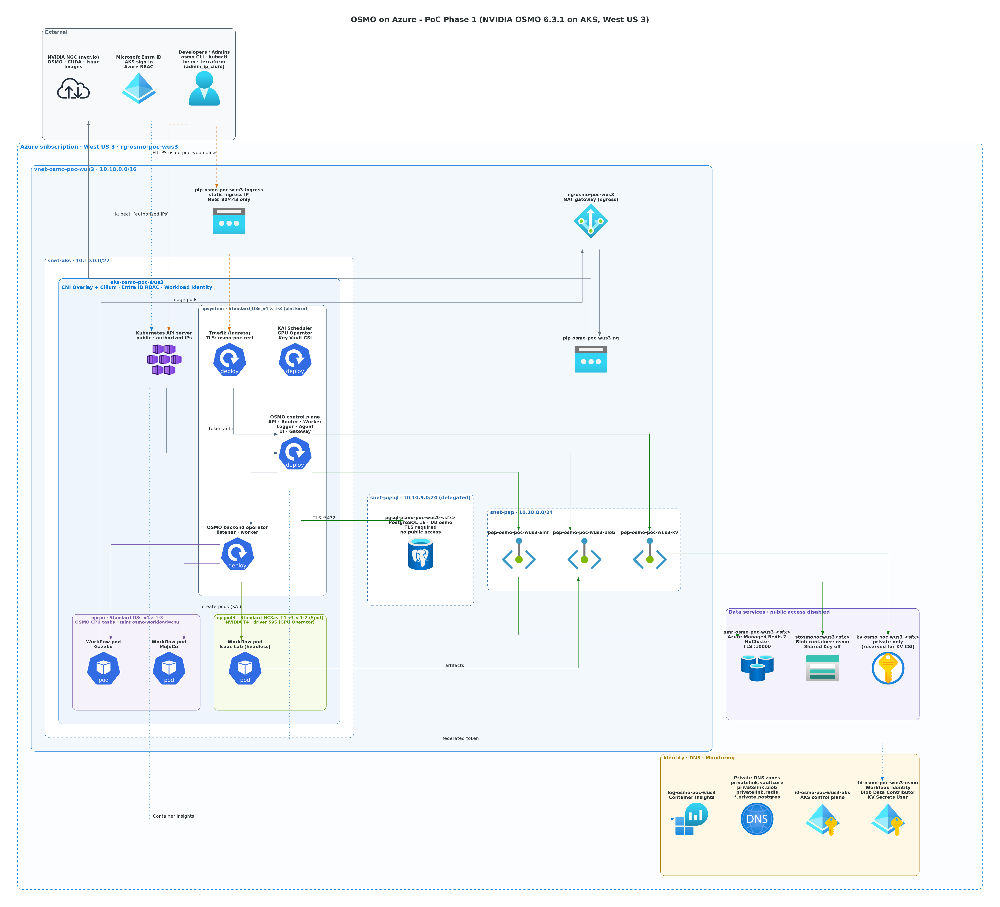

# osmo-on-azure

English | [简体中文](README.zh-CN.md)

Deploy [NVIDIA OSMO](https://github.com/NVIDIA/OSMO) on Azure to give embodied-AI and robotics teams a cloud-based scheduling platform for simulation jobs.

## Architecture (PoC phase 1)

_Edges: green = private (VNet / Private Link) · orange dashed = public endpoint restricted to admin IPs · grey = outbound via NAT · blue dotted = identity / monitoring._

## Documents

| Document | Contents |
|---|---|
| [docs/background.md](docs/background.md) (Chinese) | Project background, technology choices, PoC success criteria, open items |
| [docs/reference-repos.md](docs/reference-repos.md) (Chinese) | Review of the reference repos (NVIDIA/OSMO, microsoft/physical-ai-toolchain): version choice, PostgreSQL TLS, reusable parts |
| [docs/operations-guide.md](docs/operations-guide.md) (Chinese) | Operations guide: resume the environment, log in, view workflow history and logs, check resources, cost control, troubleshooting |
| [docs/t4-feasibility.md](docs/t4-feasibility.md) (Chinese) | Feasibility of running Isaac Lab / Isaac Sim / MuJoCo / Gazebo on T4 GPUs |
| [docs/images/](docs/images/) | Azure architecture, OSMO deployment architecture, OSMO workflow sequence |
| [infra/terraform/](infra/terraform/README.md) | Azure infrastructure: AKS, T4 GPU node pool, private data services |
| [deploy/](deploy/README.md) | OSMO 6.3.1 deployment with Helm (GPU Operator, KAI, OSMO service, backend operator) and phase-1 acceptance workflows |

## Current technology choices (PoC phase 1)

- OSMO 6.3.1, the open-source edition, deployed with the `service` and `backend-operator` charts, version 1.3.1
- AKS in West US 3 with NVIDIA T4 GPUs (`Standard_NC*as_T4_v3`), provisioned with Terraform
- The AKS API server has a public endpoint that only accepts admin IPs. PostgreSQL, Redis, Blob storage and Key Vault are reached over private networking. Phase 1 has no container registry.
