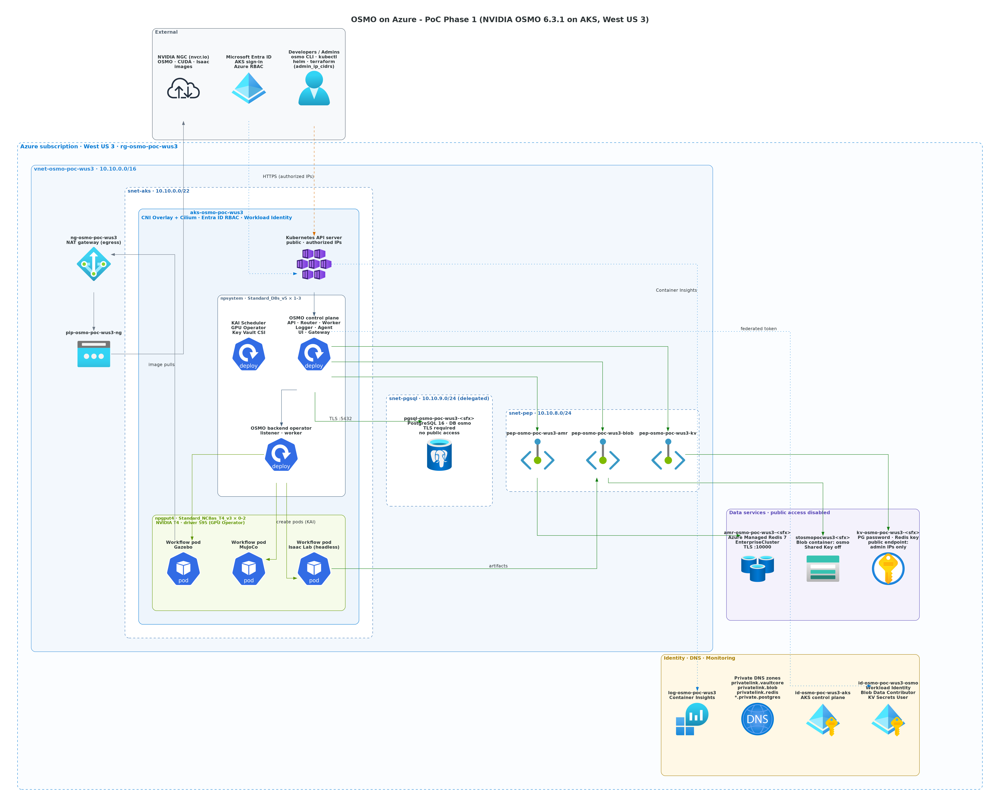

# osmo-on-azure

[English](README.md) | 简体中文

在 Azure 上部署 NVIDIA OSMO，为具身智能和机器人团队提供云端仿真作业调度方案。

## 架构（PoC 第一阶段）

_连线说明：绿色 = 私网（VNet / Private Link）· 橙色虚线 = 仅放行管理 IP 的公网入口 · 灰色 = 经 NAT 出网 · 蓝色点线 = 身份 / 监控。_

## 文档

| 文档 | 内容 |
|---|---|
| [docs/background.md](docs/background.md) | 项目背景、技术选型、PoC 成功标准、待确认事项 |
| [docs/reference-repos.md](docs/reference-repos.md) | 参考仓库研读结论（NVIDIA/OSMO、microsoft/physical-ai-toolchain）：版本选择、PG TLS、可复用内容 |
| [docs/t4-feasibility.md](docs/t4-feasibility.md) | T4 GPU 运行 Isaac Lab / Isaac Sim / MuJoCo / Gazebo 的可行性评估 |
| [docs/images/](docs/images/) | Azure 部署架构图、OSMO 部署架构图、工作流时序图 |
| [infra/terraform/](infra/terraform/README.zh-CN.md) | Azure 基础设施（AKS、T4 GPU 池、私网数据组件） |

## 当前技术选型（PoC 第一阶段）

- OSMO 6.3.1（开源版，chart `service` / `backend-operator` 1.3.1）
- AKS 部署在 westus3，GPU 用 T4（`Standard_NC*as_T4_v3`），基础设施用 Terraform 管理
- AKS API 第一阶段走公网（限制来源 IP）；PostgreSQL、Redis、Blob、Key Vault 走私网（第一阶段不含 ACR）
