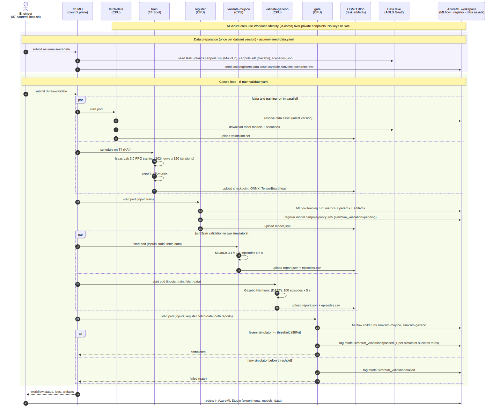

# OSMO + AzureML 闭环：数据 → 仿真训练 → 模型注册 → 仿真验证

> 状态（2026-11-09）：已在 westus3 部署并端到端跑通，包括 MuJoCo 和 Gazebo 两个仿真器的验证，以及门禁失败演示。

## 1. 目标和分工

机器人团队通常已经有仿真和训练脚本，缺的是**把数据、训练、验证串起来并留下记录**的工具：哪个模型用了哪份数据、在哪个仿真器里验证过、结果如何。这里假设客户还没有实验管理和模型管理工具。

| 角色 | 组件 | 负责 |
|---|---|---|
| 执行 | NVIDIA OSMO（AKS） | 调度和运行仿真、训练、验证任务；GPU / CPU 资源；任务产物存到 Blob |
| 记录系统 | Azure Machine Learning 工作区 | MLflow 实验跟踪（指标、参数、产物）；模型注册表（版本、标签、血缘）；数据资产 |
| 数据 | ADLS Gen2 数据湖 | 机器人数据（这里放的是仿真验证集），注册为 AzureML 数据存储 `robotics_data` |

设计要点：

- **不在 AKS 上安装 AzureML 扩展。** 它依赖 Volcano，与 OSMO 使用的 KAI Scheduler 冲突，还要求 AKS 开启本地账号。OSMO 任务直接调用 AzureML 的 API（MLflow 和 `azure-ai-ml` SDK）。
- **全部使用 Workload Identity。** 所有 OSMO 任务 Pod 都以 `osmo-workflow` 服务账号运行，它联合到托管身份 `id-osmo`。这个身份拥有工作区的 `AzureML Data Scientist` 角色，以及 AzureML 存储和数据湖的 `Storage Blob Data Contributor` 角色。不用账号密钥，也不用 SAS。
- **数据组件只走私网。** AzureML 默认存储和数据湖都关闭了公网访问和 Shared Key，只能通过私有终结点访问。工作区本身也有私有终结点；它的公网端点保持开启，并受 Entra ID 和 RBAC 保护，便于在浏览器里使用 Studio。

## 2. 资源

由 `infra/terraform/azureml.tf` 创建：

| 资源 | 名称（默认） | 说明 |
|---|---|---|
| AzureML 工作区 | `mlw-osmo-poc-wus3` | Basic SKU，系统分配标识，默认存储用 Identity 访问 |
| Application Insights | `appi-osmo-poc-wus3` | 接入现有 Log Analytics |
| 工作区默认存储 | `stosmopocwus3ml<sfx>` | 存 MLflow 产物和模型文件；私有终结点：blob、file |
| 数据湖（ADLS Gen2） | `stosmopocwus3dl<sfx>`，容器 `robotics-data` | 模拟客户的机器人数据存储（PoC 与计算放在同一区域）；私有终结点：blob、dfs |
| 数据存储 | `robotics_data` | 把数据湖注册到工作区，使用 Identity 访问，不保存凭据 |
| Key Vault | 复用现有的 `kv-osmo-poc-wus3-<sfx>` | 工作区必需的依赖 |
| 私有 DNS 区域 | `privatelink.{api.azureml.ms, notebooks.azure.net, file.core.windows.net, dfs.core.windows.net}` | 链接到 VNet |

## 3. 流程



_UML 时序图：紫色区域是数据准备（每个数据版本一次），绿色区域是闭环工作流；`par` 框里的任务并行执行，`alt` 框是门禁的两种结果。_

1. **数据准备**（`deploy/workflows/azureml-seed-data.yaml`，每个数据版本跑一次）
   - 把验证集上传到数据湖 `robotics-data/cartpole/sim2sim/<版本>/`：MuJoCo 模型 `cartpole.xml`、Gazebo 模型 `cartpole.sdf`，以及 100 个初始状态 `scenarios.json`。初始状态按 Isaac-Cartpole 的重置分布采样，随机种子固定。
   - 注册为 AzureML 数据资产 `cartpole-sim2sim-scenarios:<版本>`。v1 只含 MuJoCo 模型，v2 加入了 Gazebo 模型。
2. **取数据**（`fetch-data`，CPU，与训练并行）
   - 通过 AzureML 数据资产（默认最新版本）找到数据湖中的目录并下载，供两个验证任务使用。
3. **训练**（`train`，T4）
   - Isaac Lab 3.0 headless（Newton 物理）用 RSL-RL PPO 训练 `Isaac-Cartpole`，默认 1024 个并行环境、150 次迭代，约 1.5 分钟。
   - 用 Isaac Lab 官方的 play 脚本把策略导出为 ONNX（导出完成后即停止回放）。
4. **登记**（`register`，CPU）
   - rsl_rl 只写 TensorBoard，所以这一步把 TensorBoard 指标回放到 AzureML 的 MLflow 运行（实验 `cartpole-rl`），并记录关键超参数。
   - 上传 ONNX 策略、checkpoint 和配置文件，注册模型 `cartpole-policy` 的新版本，打标签 `sim2sim_validation=pending`，并附上 `osmo_workflow_id`。
5. **仿真验证**（`validate-mujoco`、`validate-gazebo`，CPU，并行）
   - 两个任务用同一个 ONNX 策略、同一组 100 个初始状态，各自在自己的仿真器里跑 100 个回合，每个回合 5 秒（控制 60 Hz，物理 120 Hz，与 Isaac Lab 相同）。
   - 回合成功的条件：小车始终在 ±3 m 内（Isaac Lab 的终止边界），且最后 1 秒摆杆平均偏角小于 0.2 rad。
   - 两个任务只做仿真，输出 `report.json` 和逐回合的 `episodes.csv`，不依赖任何云端库。仿真器无关的部分（策略推理、回合评分、报告）在 `sim2sim_common.py` 中共用。
6. **门禁**（`gate`，CPU）
   - 为每个仿真器记录一个 MLflow 子运行（`sim2sim-mujoco`、`sim2sim-gazebo`，父运行是训练运行），附上所用数据资产版本。
   - 更新模型标签：`sim2sim_validation=passed|failed`、`sim2sim_mujoco` / `sim2sim_gazebo`（各自的成功率）、`sim2sim_threshold`、`sim2sim_data_asset`。
   - 任一仿真器的成功率低于门限（默认 90%）时，模型标为 `failed`，`gate` 任务失败，整个工作流显示为失败。

## 4. Sim2sim：MuJoCo / Gazebo 模型怎么对齐 Isaac Lab

`cartpole.xml`（MuJoCo）和 `cartpole.sdf`（Gazebo）位于 `deploy/workflows/files/rl/`，参数取自 Isaac Lab 官方资产 `Robots/Classic/Cartpole/cartpole.usd` 和 `isaaclab_assets/robots/cartpole.py`：

| 项 | 值 |
|---|---|
| 小车 | 0.25 × 0.20 × 0.20 m 长方体，1 kg；滑轨限位 ±4 m |
| 摆杆 | 0.06 × 0.04 × 1.0 m 长方体，1 kg，质心在铰链上方 0.47 m |
| 驱动 | 滑轨隐式执行器：刚度 0、阻尼 10、力上限 400 N；动作缩放 100 |
| 观测 | `[小车位置, 摆角, 小车速度, 摆角速度]` |
| 时间步 | 物理 1/120 s，策略每 2 个物理步执行一次 |

USD 中小车沿 +Y 移动、摆杆绕 +X 转动；两个移植模型中小车沿 +X 移动，铰链轴取 -Y，使摆角的正方向与 Isaac Lab 一致。

**Gazebo 的驱动方式。** 使用 Gazebo Harmonic（gz-sim 8，DART 物理引擎），通过 `gz.sim8` 的 Python 绑定（`TestFixture`）在进程内同步步进：每个控制步先在 pre-update 回调里给滑轨关节施加力，运行 2 个物理步，再在 post-update 回调里读关节位置和速度。这种方式不需要 ROS 2，也不经过 gz-transport 的异步消息，每一步都是确定的。
- 依赖从 OSRF 官方 apt 源安装：`python3-gz-sim8`、`libgz-sim8-plugins`、`libgz-physics7-dartsim-dev`，约 2 分钟。
- Gazebo 在下一次物理更新时才应用关节复位，所以每个回合先跑 1 个零力的复位步。复位后会检查关节状态是否等于初始状态，防止物理插件缺失之类的问题让仿真“静止不动”却得出全部成功的假结果。
- 如果被验证的机器人需要 ROS 2 控制栈（ros2_control、传感器话题），可以换成 ROS 2 + `ros_gz` 的方式，门禁和 AzureML 记录部分不用改。

用同一个 LQR 参考控制器检查过两个模型：MuJoCo 和 Gazebo 的平均回合奖励分别是 4.947 和 4.945，说明两个模型的动力学基本一致。

**这是同一个机器人在不同物理引擎之间的迁移验证（sim2sim），不是 sim2real。** 对复杂机器人，引擎之间在接触、摩擦和执行器建模上的差异会大得多，这正是需要在多个仿真器里独立验证的原因。

## 5. 运行

前提：已 apply `infra/terraform`（包括 `azureml.tf`），并完成 `deploy/` 的第 1–3 步。

```bash
deploy/scripts/07-azureml-loop.sh            # 数据准备 + 闭环
deploy/scripts/07-azureml-loop.sh loop       # 只跑闭环（数据资产已存在）
DATASET_VERSION=2 deploy/scripts/07-azureml-loop.sh seed     # 发布新的数据版本
LOOP_SET="max_iterations=300 threshold=0.95" deploy/scripts/07-azureml-loop.sh loop
LOOP_SET="max_iterations=5" deploy/scripts/07-azureml-loop.sh loop   # 门禁失败演示：欠训练的策略
```

脚本从 Terraform 输出读取工作区信息，再通过 `osmo workflow submit --set-string` 传给工作流。也可以手动提交：

```bash
osmo workflow submit deploy/workflows/rl-train-validate.yaml --pool default \
  --set-string aml_subscription_id=<订阅 ID> aml_resource_group=<资源组> aml_workspace=<工作区>
```

可调参数（`default-values`）：`num_envs`、`max_iterations`、`threshold`、`experiment`、`model_name`、`dataset`（`name` 或 `name:version`）。

## 6. 在 AzureML Studio 中查看

打开 https://ml.azure.com ，选择工作区 `mlw-osmo-poc-wus3`：

- **Jobs → 实验 `cartpole-rl`**：每次训练对应一个运行 `train-<时间戳>`，包含奖励、回合长度、损失等曲线和超参数。仿真验证运行 `sim2sim-mujoco` 和 `sim2sim-gazebo` 是它的子运行，包含成功率、平均奖励等指标和逐回合结果。
- **Models → `cartpole-policy`**：每个版本的标签显示来源的 OSMO 工作流、训练器、每个仿真器的成功率、所用验证集版本和门禁结论，可以按 `sim2sim_validation=passed` 筛选可用的模型。
- **Data → `cartpole-sim2sim-scenarios`**：验证集的版本，以及它在数据湖中的位置。

注意：AzureML 存储和数据湖只能通过私网访问，所以从 VNet 外打开 Studio 时，指标、参数、标签和血缘都能正常显示，但**预览或下载产物文件会失败**。需要时从 VNet 内的跳板机访问，或者用 OSMO 任务读取。

## 7. 实测结果（2026-11-09）

**正常训练（工作流 `rl-train-validate-4`，150 次迭代）：通过**

| 任务 | 结果 |
|---|---|
| fetch-data | 解析数据资产 `cartpole-sim2sim-scenarios:2`，从数据湖下载 3 个文件（私有终结点 + Workload Identity） |
| train | T4 上 1024 环境 × 150 次迭代约 1.5 分钟；ONNX 导出成功 |
| register | 21 个 TensorBoard 指标、3150 个数据点写入 MLflow；注册 `cartpole-policy:4` |
| validate-mujoco | MuJoCo 3.17：100/100 回合成功，平均回合奖励 4.946，最终摆角平均 0.0023 rad |
| validate-gazebo | Gazebo Harmonic（gz-sim 8，DART）：100/100 回合成功，平均回合奖励 4.944，最终摆角平均 0.0023 rad；100 个回合约 12 秒 |
| gate | 两个仿真器都达标，模型标签 `sim2sim_validation=passed`、`sim2sim_mujoco=1.000`、`sim2sim_gazebo=1.000` |

从提交到 gate 结束约 12 分钟；训练只占约 2 分钟，其余主要是任务之间的产物传输和依赖安装（Gazebo 约 2 分钟）。Isaac Lab 默认使用固定随机种子，所以相同配置下重复训练得到的策略和验证指标完全一致。

**门禁失败演示（`LOOP_SET="max_iterations=5"`，只训练 5 次迭代）：被拦下**

工作流 `rl-train-validate-5`：

| 任务 | 结果 |
|---|---|
| train / register | 正常完成，注册 `cartpole-policy:5`（标签 `pending`） |
| validate-mujoco | 成功率 0%：100 个回合都因小车冲出 ±3 m 而提前终止，平均回合奖励 -11.9 |
| validate-gazebo | 成功率 0%：同样全部冲出边界，平均回合奖励 -12.0 |
| gate | `sim2sim gate failed (threshold 90%): mujoco 0%, gazebo 0%`；模型标签改为 `sim2sim_validation=failed`；`gate` 任务失败，工作流状态为 `FAILED` |

失败的模型版本仍保留在模型注册表里，训练曲线、两个仿真器的逐回合结果都可以在 AzureML 中查看，便于分析原因；按 `sim2sim_validation=passed` 筛选时不会出现。

T4 Spot 节点在训练中可能被抢占（实测遇到过一次）。被抢占的工作流会以 `FAILED_BACKEND_ERROR` 结束，重新提交即可。

## 8. 后续可扩展

- **更复杂的机器人**：腿式机器人等需要 ROS 2 控制栈时，Gazebo 验证可以改用 ROS 2 + `ros_gz`；也可以按同样方式加入 Isaac Sim 作为第三个仿真器。
- **镜像**：把 Python 依赖和 Gazebo 预装进镜像并推到 ACR，省去每个任务 30 秒到 2 分钟的安装时间。
- **数据位置**：客户数据在其他区域时，数据湖可以放在数据所在区域，再通过 AzureML 数据存储引用；训练位置按算力和合规要求选择。
- **模型发布**：在通过验证的模型版本上加审批流程（例如 Azure DevOps / GitHub Actions），再发布到边缘设备。
