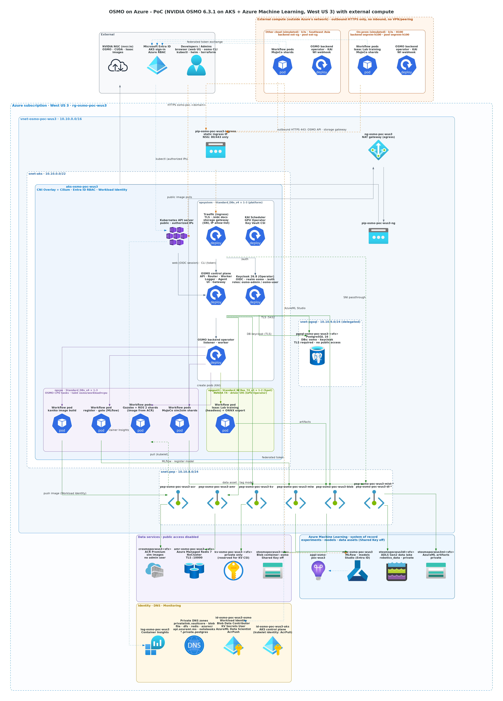
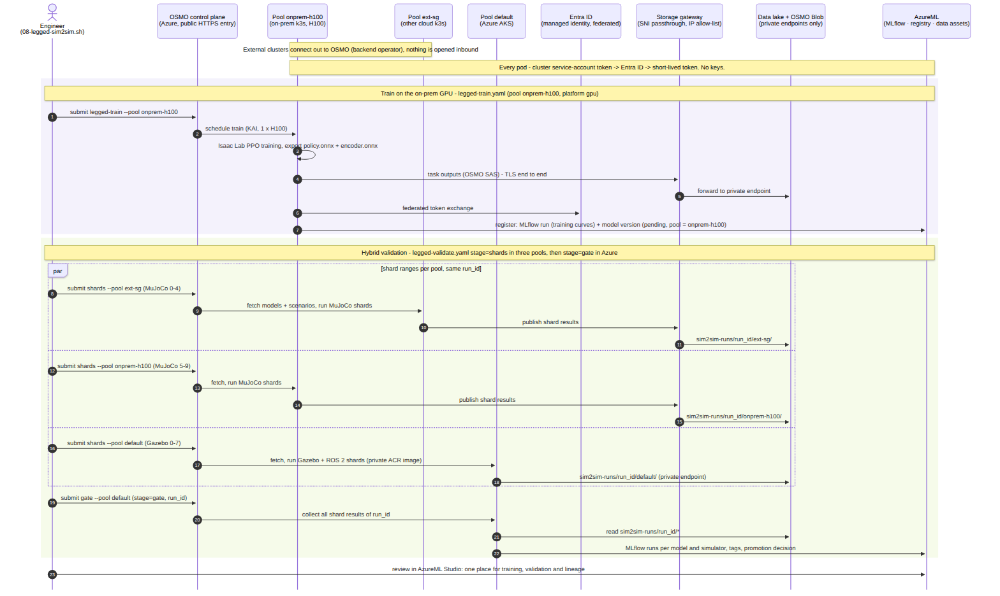

# 混合云机器人训练与仿真验证流水线：算力在哪里都行，结果集中在 Azure

> 状态（2026-11-11）：已在 westus3 端到端跑通。一个 OSMO 控制面（Azure）调度三类算力：Azure AKS、其他云（模拟，新加坡的 k3s）、本地机房（模拟，H100 服务器上的 k3s）。本地 GPU 训练 → AzureML 登记 → 三个资源池并行做 MuJoCo / Gazebo（ROS 2）仿真验证 → 结果汇总到 Azure 数据湖 → 门禁决定是否晋级。

## 1. 要解决的问题

很多机器人团队的算力分散在多家云厂商和自己的机房里，各处各放一份数据：

- **调度靠人**：研发要知道哪台机器空、手工登录、手工搬数据，没法批量、并行，也没有统一的排队和记录。
- **sim2sim 验证靠手**：策略训练好后，在 MuJoCo 等仿真器里用手柄发指令、看会不会摔，一次只看一个场景；结果没有记录，新旧模型没法比较。
- **结果分散**：训练曲线、模型文件、验证结论散在各个集群上，说不清某个模型在什么数据、什么条件下验证过。

本方案不要求迁移算力，而是把**调度入口和数据、结果**集中到 Azure：

| 价值 | 做法 |
|---|---|
| 一个入口调度所有算力 | NVIDIA OSMO 控制面在 Azure；Azure AKS、其他云和本地的 Kubernetes 集群各装一个 backend operator，作为资源池接入。外部集群只发起出站 HTTPS 连接，不开放入站端口，不需要网络互联 |
| 结果集中在 Azure、安全可控 | 训练曲线、模型版本、验证结果写入 AzureML 和私有数据湖；外部集群经存储网关（TLS 端到端、IP 白名单）访问私有存储，用联合身份换取短时令牌，不分发任何密钥。详见 [私有存储的安全设计](private-storage-security.md) |
| 用现有的大卡训练 | 本地 H100 上用 Isaac Lab 训练，自动登记到 AzureML 模型注册表（训练曲线、源代码 commit、所在资源池） |
| 手工 sim2sim → 自动化、批量化 | 1000+ 个场景（速度指令 × 摩擦 × 负载 × 推力 × 延迟），切成多个分片分发到多个资源池并行 |
| 多仿真器交叉验证，接上现有工具 | MuJoCo（复现的部署控制循环）+ Gazebo Classic（厂商自己的 ROS 2 部署栈，与真机同一份控制器代码）；必须在两个仿真器中都通过 |
| 门禁和模型治理 | 按摔倒率和速度跟踪判定；冠军 / 挑战者晋级（`stage=production`）；场景集升级后重新验证所有版本，血缘可追溯 |

[AzureML 闭环](azureml-loop.md) 用 Cartpole 证明了这套机制，本文把它用到一个真实的点足双足机器人上，并扩展到多云 + 本地。

## 2. 混合云架构



| 资源池（OSMO backend） | 位置 | 算力 | 承担的工作 |
|---|---|---|---|
| `default` | Azure AKS（westus3） | CPU 节点池 D8s_v4 × 1–3、T4 Spot | Gazebo + ROS 2 验证分片（镜像在私有 ACR）、门禁、数据准备 |
| `ext-sg` | 其他云（模拟）：新加坡的 k3s，独立网络、独立资源组 | 16 vCPU | MuJoCo 验证分片 |
| `onprem-h100` | 本地机房（模拟）：H100 服务器上的 k3s，另一个订阅和网络 | 40 vCPU + 1 × H100 | Isaac Lab 训练（`gpu` 平台）、MuJoCo 验证分片 |

外部集群（`ext-sg`、`onprem-h100`）与 Azure 之间**只有出站 HTTPS**，全部经过 OSMO 的公网入口（固定 IP，443）：

| 通道 | 做法 |
|---|---|
| 调度 | backend operator 用令牌主动连接 OSMO（WebSocket）；作业 Pod 里的 osmo-ctrl 经同一入口回传日志和状态（`service_base_url` 设为公网 URL） |
| 身份 | 外部集群的服务账号令牌签发方（OIDC）发布在 `https://<osmo-host>/oidc/<集群名>`；托管身份 `id-osmo` 上为每个集群建一条联合凭据；集群里装 Azure Workload Identity webhook。作业代码照常用 `DefaultAzureCredential`，与 AKS 上完全相同 |
| 存储 | 存储账号只走私网（订阅策略强制）。公网入口上的**存储网关**按 SNI 把 `<账号>.blob/dfs.core.windows.net` 透传到私有终结点，只放行外部集群的出口 IP；外部集群的 DNS 把这些域名解析到入口 IP |
| 镜像 | ACR 只放行外部集群的出口 IP；PoC 中需要私有镜像的 Gazebo 分片放在 AKS 上运行 |
| 运维 | 外部集群没有任何入站规则（连 SSH 也没有）。运维命令通过云厂商的管理面通道执行：PoC 里是 `az vm run-command`，其他云有对应的云助手类服务 |

接入一个新的外部集群：在该机器上运行 `deploy/scripts/external/k3s-node.sh`，在 Terraform 中登记出口 IP 和 OIDC 签发方，再运行 `deploy/scripts/09-external-backend.sh join <名称> <kubeconfig>`。详见第 10 节。

## 3. 端到端流程



_UML 时序图：紫色区域在本地 GPU 上训练并登记模型；绿色区域是混合验证，`par` 框里三个资源池并行，结果汇总到数据湖后在 Azure 上过门禁。_

| 工作流 | 资源池 | 任务 | 说明 |
|---|---|---|---|
| `legged-train.yaml` | `onprem-h100`（`gpu` 平台） | `train` | Isaac Lab 2.1（Isaac Sim 4.5）+ 厂商的 RL 扩展，PPO 训练（默认 2000 次迭代，4096 个并行环境），再用厂商的 play 脚本导出 `policy.onnx` + `encoder.onnx` |
| | | `register` | TensorBoard 指标批量写入 MLflow 运行；模型登记为 `pointfoot-policy` 的新版本（标签：`source=trained`、`compute_pool`、源代码 commit、`sim2sim_validation=pending`） |
| `legged-validate.yaml`（`stage=shards`） | 每个参与的资源池 | `fetch`、分片、`publish` | 取模型和场景集，跑分到本池的分片范围（`mujoco_from/to`、`gazebo_from/to`），结果上传到数据湖 `sim2sim-runs/<run_id>/<资源池>/` |
| `legged-validate.yaml`（`stage=gate`） | `default` | `fetch`、`collect`、`gate` | 收集同一 `run_id` 下所有资源池的分片结果，校验分片齐全，按仿真器打分、记录、打标签、决定是否晋级 |
| `legged-validate.yaml`（`stage=all`） | 任一资源池 | 全部 | 不拆分，一个工作流完成（第 7.2 节的结果用这种方式） |
| `legged-seed.yaml` | `default` | `seed-scenarios`、`import-policies` | 生成场景集并登记为数据资产；导入公开发布的预训练策略 |
| `build-image.yaml` | `default` | `build` | 在集群内用 kaniko 构建 Gazebo（ROS 2）镜像，推到私有 ACR |

OSMO 的一个工作流只能在一个资源池中运行（所有任务使用同一个后端），所以跨池的一次验证由 `08-legged-sim2sim.sh campaign` 编排：并行提交各池的 `stage=shards` 工作流，全部完成后在 Azure 提交 `stage=gate`。

## 4. 机器人、策略与仿真器

示例面向使用 rsl_rl 训练、导出为 `policy.onnx` + `encoder.onnx` + `params.yaml` 的**点足双足机器人盲走速度跟踪策略**（6 个关节：每条腿 abad / hip / knee）。机器人模型（MJCF + 网格）和策略都从 git 仓库获取，地址在提交脚本的 `legged.env` 中配置（模板见 `deploy/scripts/legged.env.example`），仓库本身不包含任何机器人资产。

`deploy/workflows/files/legged/pointfoot_sim.py` 用官方 `mujoco` Python 包复现了这类机器人常见的部署控制循环，不需要厂商 SDK、进程间通信或手柄：

| 项 | 值 |
|---|---|
| 物理 / 控制 / 策略频率 | 1 kHz / 500 Hz / 50 Hz（decimation 10） |
| PD | 每个物理步 `Kp*(q*-q) - Kd*dq`，增益和力矩上限取自 `params.yaml` |
| 观测（30 维） | 机身角速度、投影重力、关节位置（相对默认姿态）、关节速度、上一步动作、步态时钟 sin/cos、步态参数（4） |
| Encoder | 10 帧观测历史（300 维）→ 机身线速度估计（3 维） |
| Policy 输入 | `[encoder 输出, 观测, 速度指令 (vx, vy, wz)]` → 6 个关节位置偏移 |
| 关节顺序 | Isaac Gym 版按腿排列；Isaac Lab 版按关节类型交错，由模型的 `rl_type` 决定映射 |
| 摔倒判定 | 机身高度 < 0.45 m、倾角 > 1 rad，或机身碰地 |
| 热身 | 复位后先零指令原地踏步 2 s（像操作员先启动策略再推摇杆），之后才是场景时间 0；热身期间摔倒算作摔倒 |
| 速度跟踪误差 | 0.5 s 滑动平均后的机身水平速度（航向坐标系）与指令之差的 RMSE；跳过场景开始后 1 s、指令切换后 0.5 s、被推后 1.5 s |

摔倒判定和误差计算在 `episode_metrics.py` 中，MuJoCo 和 Gazebo 共用同一套规则。

复现的正确性：零指令下两套公开发布的预训练策略 10 秒的漂移分别约 1.6 m 和 0.7 m，与厂商公布的实测范围（0.7–1.7 m）一致。仿真是确定性的，MuJoCo 3.17 和 4.0 的摔倒判定逐回合一致。

### 4.1 第二仿真器：Gazebo（ROS 2）

Gazebo 这一侧不复现控制循环，而是直接运行厂商开源的 ROS 2 部署栈：Gazebo Classic 11（ODE，2 ms 步长）+ ros2_control 硬件插件（经厂商 SDK 的仿真库连接）+ C++ RL 控制器（ONNX 推理，订阅 `/cmd_vel`）。它和真机上用的控制器是同一份代码，所以这一侧同时验证了“部署软件栈 + 另一个物理引擎”。

| 项 | 做法 |
|---|---|
| 镜像 | `deploy/images/legged-gazebo-ros2/Dockerfile`：`osrf/ros:iron-desktop-full` + Gazebo Classic + ONNX Runtime 1.10 + 四个厂商仓库（地址作为构建参数，来自 `legged.env`）编译。由 `build-image.yaml` 在集群内用 kaniko 构建（无需特权和 Docker 守护进程），通过 Workload Identity 推到私有 ACR（约 4 分钟） |
| 每个场景 | 一套全新进程：xacro → URDF（按场景改脚部摩擦 `mu1/mu2`、机身质量，注入 p3d 真值插件）→ gzserver 暂停启动 → 生成机器人 → 启动厂商硬件节点（6 s 后自动启动控制器）→ 控制器站立阶段结束时恢复物理 |
| 驱动 | `gazebo_episode.py`（rclpy）：按场景时间发布 `/cmd_vel`（除以控制器的 `user_cmd_scales`），用 `/apply_link_wrench` 施加推力，50 Hz 记录机身真值。推力请求的 `start_time` 必须填当前仿真时间：插件按 `start_time + duration` 计算结束时间，留空（0）时任务会被当作已过期直接丢弃，而服务照样返回成功。每个回合都记录推力调用结果和被推后的速度峰值，便于发现这类问题 |
| 实时性 | 控制器按墙钟 500 Hz 运行，Gazebo 必须实时（实时因子 1.0）；每个回合记录实时因子，低于 0.9 的回合无效 |
| 启动失败 | Gazebo 中从静止起步时，相当一部分回合在恢复物理后约 0.31 s 摔倒（时间点固定，与指令无关，摩擦越低越多；MuJoCo 中没有这种现象）。恢复物理后 0.5 s 内的摔倒记为启动失败，自动重试（最多 5 次），单独统计；之后的摔倒（包括热身期间）都算真实摔倒。5 次都启动失败的回合记为无效，门禁按场景组报告无效回合数 |
| 隔离 | `ROS_AUTOMATIC_DISCOVERY_RANGE=LOCALHOST` + 只走 UDP 的 Fast DDS 配置：同一网络中的分片不会互相发现节点（否则一个分片的 `/cmd_vel` 会被另一个分片的控制器收到） |
| 规模 | 实时仿真，每个 20 s 场景连同启动约 35 s，每个分片 2 CPU。默认跑 201 个场景的子集：120 个分布内（含组合扰动）+ 81 个分布外（摩擦、负载、推力各 27 个），按场景组均匀抽取 |
| 限制 | 厂商控制器无法注入观测延迟，Gazebo 子集跳过延迟维度；ROS 2 Iron 和 Gazebo Classic 都已停止维护（apt 源是 Iron 的冻结快照），镜像预构建后不受影响 |

## 5. 场景集

`scenarios.py` 按固定随机种子生成。每个场景 20 秒，含 4 段 5 秒的速度指令（站立 / 前后 / 侧移 / 转向 / 混合，范围 vx ±0.75 m/s、vy ±0.5 m/s、wz ±0.25 rad/s，即手柄的指令范围），再叠加物理扰动：

| 扰动 | 训练分布内 | 分布外 |
|---|---|---|
| 地面摩擦 | 0.4–1.2 | 0.15–0.4 |
| 机身附加质量 | -1 – +2 kg | 2–6 kg |
| 推力（0.1 s，水平随机方向） | 0–100 N（约 10 N·s） | 100–300 N |
| 观测延迟 | 0–10 ms | 20–60 ms |

| 版本 | 内容 |
|---|---|
| v1（1000 个） | 600 个分布内（四个扰动都在范围内随机）+ 400 个分布外（每个维度 100 个：只把这一个维度推到范围外，其余保持标称值，便于归因） |
| v2（1200 个） | v1 + 200 个“组合扰动”：滑地面 + 负载 + 被推 + 延迟同时出现，每一项都还在训练分布内，模拟现场事故中的组合工况 |

分布内的范围参照该类机器人训练时的域随机化设置。

## 6. 门禁规则

每个仿真器分别判定，**所有仿真器都通过**才算通过。只用**训练分布内**的场景判定（v2 包括组合扰动），分布外的场景只用于展示和诊断；Gazebo 中的无效回合（实时因子过低，或重试后仍启动失败）不参与统计：

- 摔倒率 ≤ 5%（`max_fall_rate`）
- 未摔倒回合的平均速度跟踪 RMSE ≤ 0.3 m/s（`max_lin_vel_rmse`）
- 转向跟踪 RMSE 只报告，不参与判定

`mode=promote`（`08-legged-sim2sim.sh validate`）：

- 挑战者没通过门禁 → 标签 `stage=rejected-gate`，工作流失败。
- 通过门禁，但在任一仿真器中摔倒率比冠军高 1 个百分点以上，或速度 RMSE 高 0.02 m/s 以上 → `stage=rejected-champion`，冠军不变。
- 否则晋级：挑战者 `stage=production`，原冠军 `stage=archived`。没有冠军时，通过门禁即晋级。

`mode=revalidate`（`08-legged-sim2sim.sh revalidate`）：对全部版本重新打分并更新标签，不做晋级；如果当前生产模型在新数据上不再通过门禁，工作流失败，提醒需要处理。

每个模型版本的标签：`sim2sim_validation=passed|failed`、`sim2sim_data_asset`、`sim2sim_simulators`、`sim2sim_<仿真器>_fall_rate`、`sim2sim_<仿真器>_lin_vel_rmse`、`sim2sim_fall_rate` / `sim2sim_lin_vel_rmse` / `sim2sim_ood_fall_rate`（各仿真器中最差的值）、`stage`。

## 7. 实测结果

> **适用范围**：以下数字来自本仓库的场景集、判定标准，以及 MuJoCo 一侧复现的部署控制循环（第 4 节），用来演示平台流程，不代表对任何策略的质量评价。门槛只是示例默认值。

### 7.1 混合云：本地训练 + 三个资源池并行验证（2026-11-11）

一次完整的混合运行：本地 H100 上训练新策略，三个资源池并行验证，Azure 上门禁。

| 步骤 | 工作流 | 资源池 | 结果 |
|---|---|---|---|
| 训练 | `legged-train-4` | `onprem-h100`（H100） | Isaac Lab 2.1，4096 个并行环境 × 2000 次迭代，约 34 分钟（约 1 次迭代 / 秒）；平均奖励 8.43，平均回合长度约 970 步；导出 ONNX |
| 登记 | `legged-train-7`（`from_workflow=legged-train-4`） | `onprem-h100` | 36 条训练曲线（7,236 个点）写入 MLflow；登记 `pointfoot-policy:3`（`source=trained`、`compute_pool=onprem-h100`、源代码 commit） |
| 验证分片 | `legged-validate-10` | `ext-sg`（其他云） | MuJoCo 分片 0–4：每片约 3 分钟，5 分钟内完成并发布到数据湖 |
| | `legged-validate-11` | `onprem-h100`（本地） | MuJoCo 分片 5–9：每片约 3 分钟，5 分钟内完成 |
| | `legged-validate-12` | `default`（Azure） | Gazebo + ROS 2 分片 0–7：每片 32–35 分钟（实时仿真），含节点池扩容共 72 分钟 |
| 门禁 | `legged-validate-13` | `default` | 收集 `run-20261111-092953` 的 18 个分片（3 个资源池），2 分钟出结论 |

从提交分片到门禁结论约 74 分钟，瓶颈是 Gazebo 的实时仿真；MuJoCo 分片因为外部资源池的机器专用、不用排队，比全部放在 AKS 上快得多。

门禁结论（场景集 v2；v3 为挑战者，v1 为冠军）：

| 指标 | v3 MuJoCo | v3 Gazebo | v1 MuJoCo | v1 Gazebo |
|---|---|---|---|---|
| 分布内摔倒率（门禁 ≤ 5%） | **34.1%** | 0.8% | 0.0% | 0.0% |
| — 其中组合扰动 | 85.5% | 3.3% | 0.0% | 0.0% |
| 速度跟踪 RMSE（门禁 ≤ 0.3 m/s） | **0.341** | **0.323** | 0.244 | 0.167 |
| 转向跟踪 RMSE | 0.021 | 0.011 | 0.171 | 0.171 |
| 分布外摔倒率 | 57.2% | 22.5% | 17.5% | 0.0% |
| 门禁 | 不通过 | 不通过 | 通过 | 通过 |

v3 被标为 `stage=rejected-gate`，v1 保持 `stage=production`，工作流按设计以失败结束。v3 只训练了 2000 次迭代（该任务的默认值是 15000 次），属于欠训练，门禁拦下它是预期的结果；训练完整后同一流程即可让新模型参与晋级。

这次运行同时验证了：

- **一个入口，三处算力**：训练和验证提交到同一个 OSMO，分片分别在 Azure、其他云和本地执行；外部集群没有任何入站端口。
- **结果集中、可追溯**：三个资源池的分片结果按 `sim2sim-runs/<run_id>/<资源池>/` 写入 Azure 私有数据湖；模型 v3 的训练曲线、所在资源池、验证结论都在 AzureML 中。
- **安全**：外部集群经存储网关访问私有存储，用联合身份换取短时令牌，全程没有密钥（见 [私有存储的安全设计](private-storage-security.md)）。
- **门禁不看算力在哪**：分片来自哪个资源池不影响判定；分片不齐（某个资源池失败）时门禁直接报错，不会基于不完整的数据给出结论。

### 7.2 单一资源池：两个仿真器的对比（2026-11-10）

被测模型：同一款点足机器人公开发布的两套预训练策略，`pointfoot-policy:1`（Isaac Gym 训练）和 `pointfoot-policy:2`（Isaac Lab 训练）。全部在 Azure 的 `default` 资源池中运行（`stage=all`）。

最后一次完整运行（`legged-validate-9`，2 个模型在场景集 v2 上重新验证，MuJoCo + Gazebo）：

| 项 | 结果 |
|---|---|
| 工作量 | MuJoCo 2,400 个回合（2 × 1,200）+ Gazebo 402 个回合（2 × 201，另有约 220 次启动重试） |
| 编排 | 1 个工作流、20 个任务：fetch → 10 个 MuJoCo 分片（1 CPU）+ 8 个 Gazebo 分片（2 CPU，私有 ACR 镜像）→ gate；超出 3 个 CPU 节点容量的分片由 OSMO 自动排队 |
| 时间 | 从提交到门禁结束约 75 分钟；串行估算约 5.5 小时（MuJoCo 约 80 分钟 + Gazebo 约 4 小时）。时间主要受 CPU 节点池上限（3 个节点）限制，调大 `cpu_node_max_count` 可以进一步缩短 |
| 记录 | AzureML 中每个模型、每个仿真器一个 MLflow 子运行（指标、逐回合结果、分维度图表），关联到数据资产版本和 OSMO 工作流 ID |
| 决策 | 门禁自动给模型版本打标签：v1 `sim2sim_validation=passed`、`stage=production`；v2 `failed`、`stage=rejected-gate` |
| 安全 | 全程 Workload Identity；数据湖、AzureML 存储、ACR 只走私网；不保存任何密钥或密码 |

#### 演示过程

| 步骤 | 工作流 | 结果 |
|---|---|---|
| 发布场景集 v1、导入两套策略 | `legged-seed-2` | 数据资产 `pointfoot-sim2sim-scenarios:1`（1000 个场景）；模型 `pointfoot-policy:1`、`:2` |
| 验证 v1（还没有冠军，仅 MuJoCo） | `legged-validate-2` | 分布内摔倒 0.0%、速度 RMSE 0.241 m/s → 通过，晋级 `stage=production` |
| 验证 v2（挑战者 vs 冠军 v1，仅 MuJoCo） | `legged-validate-3` | 分布内摔倒 5.7%、速度 RMSE 0.330 m/s → 没达标，`stage=rejected-gate`，工作流失败；冠军保持不变 |
| 发布场景集 v2 | `legged-seed-3` | 数据资产 `pointfoot-sim2sim-scenarios:2`（1200 个场景，新增 200 个组合扰动） |
| 构建 Gazebo（ROS 2）镜像 | `build-image-1` | 约 3.5 分钟，推到私有 ACR |
| 全部版本在 v2 上、两个仿真器中重新验证 | `legged-validate-9` | 见下表 |

前三步在加入 2 s 热身（第 2 节）之前运行，加入热身后 MuJoCo 的数字只有小幅变化（例如 v2 在 v2 场景集上的分布内摔倒率从 17.5% 变为 18.0%）。

#### 两个仿真器的对比（场景集 v2）

| 指标 | v1 MuJoCo | v1 Gazebo | v2 MuJoCo | v2 Gazebo |
|---|---|---|---|---|
| 场景数 | 1200 | 201 | 1200 | 201 |
| 分布内摔倒率（门禁 ≤ 5%） | 0.0% | 0.0% | **18.0%** | 0.0% |
| — 其中组合扰动 | 0.0% | 0.0% | 53.0% | 0.0% |
| 速度跟踪 RMSE（门禁 ≤ 0.3 m/s） | 0.244 | 0.169 | **0.328** | **0.320** |
| 转向跟踪 RMSE（rad/s，不门禁） | 0.171 | 0.173 | 0.022 | 0.041 |
| 分布外摔倒率：低摩擦 0.15–0.4 | 17% | 0% | 100% | 30% |
| 分布外摔倒率：推力 100–300 N | 21% | 4% | 39% | 37% |
| 分布外摔倒率：负载 +2–6 kg | 0% | 0% | 0% | 0% |
| 分布外摔倒率：延迟 20–60 ms | 32% | – | 83% | – |
| 无效回合（Gazebo 启动 5 次都失败） | – | 1 | – | 3 |
| 门禁 | 通过 | 通过 | 不通过 | 不通过 |

结论：

- **两个仿真器得出相同的晋级结论，但理由不同。** v2 在 MuJoCo 中主要是摔倒（组合扰动 53%），在 Gazebo（厂商自己的 ROS 2 部署栈）中不摔，但速度跟踪不达标。只用一个仿真器，看到的只是一面。
- **差异本身就是信息。** 例如 300 N 的侧推：MuJoCo 中两个策略都容易摔倒；Gazebo 中常常不倒，但会朝推力方向持续跑开。这类物理引擎之间的差异，正是上真机前需要知道的。
- 两套策略各有长处：v2 的转向跟踪明显好于 v1。分维度的结果可以帮助训练团队判断下一版该调整什么。
- 场景集升级后对所有版本重新验证，生产模型 v1 在新数据上仍然通过；数据版本和模型版本的对应关系都记录在 AzureML 里。

运行时间（CPU 节点池 D8s_v4，最多 3 个节点）：

| 工作流 | 回合数 | 每个分片 | 从提交到门禁结束 | 串行估算 |
|---|---|---|---|---|
| MuJoCo：1 个模型 × 1000 场景 | 1000 | 约 200 s | 约 11 分钟（其中约 4 分钟等节点池从 1 个扩到 3 个） | 约 35 分钟 |
| MuJoCo：2 个模型 × 1200 场景 | 2400 | 约 460 s | 约 19 分钟 | 约 80 分钟 |
| MuJoCo + Gazebo：2 个模型 × (1200 + 201) 场景 | 2802 | MuJoCo 约 460 s，Gazebo 约 30 分钟 | 约 75 分钟 | 约 5.5 小时 |

3 个节点同时只能放下约 9 个 CPU 分片（或 MuJoCo 和 Gazebo 分片的组合），其余分片排队，所以工作流的排队超时设为 2 小时。需要更快时，调大 Terraform 变量 `cpu_node_max_count`；正式环境可以给验证单独建一个 Spot CPU 节点池，按需扩到几十个节点。

## 8. 运行

前提：已完成 [AzureML 闭环](azureml-loop.md) 的资源部署，并按 `deploy/scripts/legged.env.example` 写好 `deploy/scripts/legged.env`。Gazebo 还需要私有 ACR（`infra/terraform/acr.tf`，`acr_enabled = true`），并重跑一次 `deploy/scripts/02-osmo-service.sh`：OSMO 提交时会检查镜像能否拉取，而私有 ACR 由 AKS 的 kubelet 身份拉取，OSMO 没有凭据，脚本会把 ACR 加入 `credential_config.disable_registry_validation`，不在 OSMO 中保存任何密码。

外部资源池（第 2 节）需要先接入：Terraform 中 `external_backends_enabled = true`（外部 k3s 虚拟机、出口 IP 白名单、联合凭据，见 `infra/terraform/external.tf`），然后：

```bash
# 在外部机器上（GPU 机器加 --gpu）
deploy/scripts/external/k3s-node.sh <名称> https://<osmo-host>/oidc [--gpu] [--data-dir /data/k3s]
# 在部署机上
deploy/scripts/02-osmo-service.sh                               # 资源池和后端声明（values/osmo-service-external.yaml）、公网 service_base_url
deploy/scripts/09-external-backend.sh gateway                   # 存储网关 + OIDC 文档服务（一次）
deploy/scripts/09-external-backend.sh join <名称> <kubeconfig> [--gpu]
osmo workflow submit deploy/workflows/external-smoke.yaml --pool <名称> --set-string aml_subscription_id=... aml_resource_group=... aml_workspace=...
```

流水线：

```bash
deploy/scripts/08-legged-sim2sim.sh train                       # 在 onprem-h100 的 GPU 上训练并登记（TRAIN_POOL / TRAIN_PLATFORM 可改）
MODELS=pointfoot-policy:<n> deploy/scripts/08-legged-sim2sim.sh campaign   # 混合验证：三个资源池并行，Azure 上门禁
CAMPAIGN="ext-sg:mujoco=0:5 onprem-h100:mujoco=5:10 default:gazebo=0:8" \
  MODELS=pointfoot-policy:all deploy/scripts/08-legged-sim2sim.sh campaign  # 自定义分片分配；:all 为重新验证全部版本
```

单一资源池（第 7.2 节的用法）：

```bash
deploy/scripts/08-legged-sim2sim.sh image                       # 构建 Gazebo（ROS 2）镜像并推到 ACR
deploy/scripts/08-legged-sim2sim.sh seed import                 # 场景集 v1 + 导入策略（v1、v2）
MODELS=pointfoot-policy:1 deploy/scripts/08-legged-sim2sim.sh validate   # 无冠军，通过即晋级
MODELS=pointfoot-policy:2 deploy/scripts/08-legged-sim2sim.sh validate   # 挑战者 vs 冠军
PROFILE=v2 DATASET_VERSION=2 deploy/scripts/08-legged-sim2sim.sh seed    # 发布场景集 v2
deploy/scripts/08-legged-sim2sim.sh revalidate                  # 全部版本在最新场景集上重新验证
```

可调：`SHARDS`（MuJoCo 分片数，默认 10）、`GAZEBO_SHARDS`（默认 8，有 ACR 时生效；0 表示只跑 MuJoCo）、`LEGGED_SET="gazebo_subset_in=120 gazebo_subset_out=80"`（Gazebo 子集大小）、`DATASET`（`name` 或 `name:version`，默认最新版本）、`LEGGED_SET="max_fall_rate=0.1 max_lin_vel_rmse=0.35"`。

## 9. 在 AzureML Studio 中查看

- **Jobs → 实验 `pointfoot-sim2sim`**：`train-*` 运行是本地 GPU 上的训练（奖励、回合长度、损失等曲线，标签 `compute_pool` 记录训练所在的资源池），`import-*` 运行保存导入的预训练策略；每次验证为每个模型、每个仿真器生成一个子运行 `sim2sim-pointfoot-policy-v<n>-<mujoco|gazebo>`，包含摔倒率、速度 / 转向 RMSE、按场景组的摔倒率（`fall_rate.in_dist.compound` 等）、Gazebo 的无效回合数和启动失败次数、逐回合 `episodes-*.csv`、分维度摔倒率图 `fall_rate_by_factor.png` 和 `breakdown.json`。
- **Models → `pointfoot-policy`**：标签 `source=trained|pretrained`、`compute_pool`、`source_commit` 记录来源；按 `stage=production` 找到生产模型，按 `sim2sim_validation` 筛选，标签里能看到每个版本最近一次在哪个场景集版本上验证、结果如何。
- **Data → `pointfoot-sim2sim-scenarios`**：场景集的各个版本，标签里有各组场景数量。

和 AzureML 闭环一样，存储只走私网，从 VNet 外打开 Studio 时，指标、标签都能看，但预览产物文件会失败。
- **数据湖 `robotics-data/sim2sim-runs/<run_id>/<资源池>/`**：混合运行中每个资源池上传的分片结果（`episodes.csv`、`shard.json`），可以看到每一部分结果来自哪里。

## 10. 外部集群接入要点

接入其他云或本地 Kubernetes 集群时遇到并已在脚本中处理的问题（OSMO 6.3.1）：

| 现象 | 原因 | 处理 |
|---|---|---|
| backend operator 连上后马上断开，agent 报 `Backend <name> is not found` | OSMO 用 ConfigMap 管理配置时，agent 只接受配置中声明过的后端 | 在 `services.configs.backends` 中声明（`values/osmo-service-external.yaml`） |
| 提交被拒：`Resource validation failed` | 新资源池没有 `common_default_variables`，`USER_GPU` 等变量为空 | 资源池中声明默认变量 |
| 外部集群上的任务一直 RUNNING、日志超时 | osmo-ctrl 连接 `service_base_url`，默认是 AKS 集群内地址，外部解析不到 | 启用外部后端时 `02-osmo-service.sh` 把它设为公网 URL |
| 存储网关握手后立即断开 | 手写的 EndpointSlice 没有 `conditions.ready`，Traefik 视为不可用 | 显式设置 `ready: true` |
| k3s 的 CoreDNS 崩溃 | 默认 Corefile 已使用 `hosts` 插件，覆盖配置不能再用一次 | 存储域名放在单独的 server 块（`coredns-custom` 的 `*.server`） |
| GPU 训练任务无法调度 | kubelet 根目录在小系统盘上，临时存储不够 | `k3s-node.sh --data-dir` 时把 kubelet 根目录放到数据盘 |
| 创建 Pod 偶发失败：`failed calling webhook "mutation.azure-workload-identity.io"` | Workload Identity webhook 的 chart 默认资源只有 0.1 核 / 30 Mi：负载一高就反复从磁盘换页、探针超时被重启，重启期间创建 Pod 会失败（failurePolicy 为 Fail） | `09-external-backend.sh join` 安装时调到 1 核 / 256 Mi |
| 只有登记失败，不想重新训练 | — | `TRAIN_FROM_WORKFLOW=<工作流 ID> 08-legged-sim2sim.sh train`：用 `task: <工作流 ID>:train` 引用之前的训练产物，只跑 `register` |
| 机器重启后第一次提交失败（500） | 准入 webhook（KAI、Workload Identity）尚未就绪 | 等组件就绪后重新提交；本地机器是 Spot 时还会中断长时间训练，正式环境建议启用 OSMO 的检查点，支持断点续跑 |

