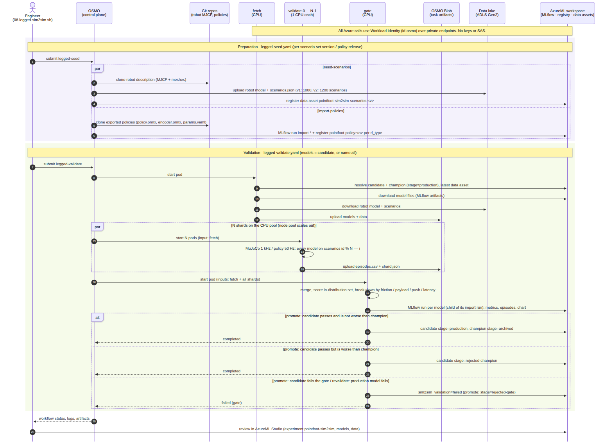

# 点足双足机器人 sim2sim 大规模验证：OSMO 并行仿真 + AzureML 门禁

> 状态（2026-11-10）：已在 westus3 端到端跑通，包括冠军 / 挑战者晋级、门禁拦截和数据升级后的重新验证。

## 1. 要解决的问题

腿式机器人的策略在 Isaac Gym / Isaac Lab 里训练好后，通常要先在另一个物理引擎（如 MuJoCo）里做 sim2sim 验证，再上真机。很多团队的做法是手工的：启动仿真器，用手柄发速度指令，看机器人会不会摔，摔了就复位再试。这样做有几个问题：

- 一次只能看一个场景，覆盖不到摩擦、负载、被推、控制延迟这些条件的组合。
- 没有记录，说不清某个模型在什么条件下验证过、结果如何。
- 没法比较：新模型比生产模型好还是差，靠印象判断。

[AzureML 闭环](azureml-loop.md) 用 Cartpole 证明了流水线能跑通。本示例把同一套机制用到一个真实的双足机器人上：

| 价值 | 做法 |
|---|---|
| 手工 → 自动化、批量化 | 1000+ 个场景（速度指令 × 摩擦 × 负载 × 推力 × 延迟），切成 N 个 OSMO 任务在 CPU 池上并行，结果全部留档 |
| 门禁拦住真实的 sim2sim 差距 | 按训练分布内场景的摔倒率和速度跟踪误差判定，按扰动维度拆解失败原因 |
| 冠军 / 挑战者 | 新模型必须通过门禁，并且不比当前生产模型差，才能晋级 `stage=production` |
| 数据版本驱动重新验证 | 场景集升级（v1 → v2）后，对所有已注册模型重新验证，血缘可追溯 |
| 弹性算力 | CPU 节点池按需扩容（实测 1 → 3 个节点），空闲后自动缩回 |

## 2. 机器人和策略

示例面向使用 rsl_rl 训练、导出为 `policy.onnx` + `encoder.onnx` + `params.yaml` 的**点足双足机器人盲走速度跟踪策略**（6 个关节：每条腿 abad / hip / knee）。机器人模型（MJCF + 网格）和策略都从 git 仓库获取，地址在提交脚本的 `legged.env` 中配置（模板见 `deploy/scripts/legged.env.example`），仓库本身不包含任何机器人资产。

`deploy/workflows/files/legged/pointfoot_sim.py` 用官方 `mujoco` Python 包复现了这类机器人常见的部署控制循环，不需要厂商 SDK、进程间通信或手柄：

| 项 | 值 |
|---|---|
| 物理 / 控制 / 策略频率 | 1 kHz / 500 Hz / 50 Hz（decimation 10） |
| PD | 每个物理步 `Kp*(q*-q) - Kd*dq`，增益和力矩上限取自 `params.yaml` |
| 观测（30 维） | 机身角速度、投影重力、关节位置（相对默认姿态）、关节速度、上一步动作、步态时钟 sin/cos、步态参数（4） |
| Encoder | 10 帧观测历史（300 维）→ 机身线速度估计（3 维） |
| Policy 输入 | `[encoder 输出, 观测, 速度指令 (vx, vy, wz)]` → 6 个关节位置偏移 |
| 关节顺序 | Isaac Gym 版按腿排列；Isaac Lab 版按关节类型交错，由模型的 `rl_type` 决定映射 |
| 摔倒判定 | 机身高度 < 0.45 m、倾角 > 1 rad，或机身碰地 |
| 速度跟踪误差 | 0.5 s 滑动平均后的机身水平速度（航向坐标系）与指令之差的 RMSE；跳过复位后 1 s、指令切换后 0.5 s、被推后 1.5 s |

复现的正确性：零指令下两套公开发布的预训练策略 10 秒的漂移分别约 1.6 m 和 0.7 m，与厂商公布的实测范围（0.7–1.7 m）一致。仿真是确定性的，MuJoCo 3.17 和 4.0 的摔倒判定逐回合一致。

## 3. 场景集

`scenarios.py` 按固定随机种子生成。每个场景 20 秒，含 4 段 5 秒的速度指令（站立 / 前后 / 侧移 / 转向 / 混合，范围 vx ±0.75 m/s、vy ±0.5 m/s、wz ±0.25 rad/s，即手柄的指令范围），再叠加物理扰动：

| 扰动 | 训练分布内 | 分布外 |
|---|---|---|
| 地面摩擦 | 0.4–1.2 | 0.15–0.4 |
| 机身附加质量 | -1 – +2 kg | 2–6 kg |
| 推力（0.1 s，水平随机方向） | 0–100 N（约 10 N·s） | 100–300 N |
| 观测延迟 | 0–10 ms | 20–60 ms |

| 版本 | 内容 |
|---|---|
| v1（1000 个） | 600 个分布内（四个扰动都在范围内随机）+ 400 个分布外（每个维度 100 个：只把这一个维度推到范围外，其余保持标称值，便于归因） |
| v2（1200 个） | v1 + 200 个“组合扰动”：滑地面 + 负载 + 被推 + 延迟同时出现，每一项都还在训练分布内，模拟现场事故中的组合工况 |

分布内的范围参照该类机器人训练时的域随机化设置。

## 4. 流程



_UML 时序图：紫色区域是准备（每个场景集版本 / 策略发布一次），绿色区域是验证；`par` 框里的任务并行执行，`alt` 框是门禁的三种结果。_

| 工作流 | 任务 | 说明 |
|---|---|---|
| `legged-seed.yaml` | `seed-scenarios` | 拉取机器人 MJCF，生成场景集，上传到数据湖 `robotics-data/legged/pointfoot/sim2sim/<版本>/`，注册数据资产 `pointfoot-sim2sim-scenarios:<版本>` |
| | `import-policies` | 拉取导出的策略，每种 `rl_type` 注册为模型 `pointfoot-policy` 的一个新版本（文件存为 MLflow 运行 `import-*` 的产物，标签记录来源仓库和 commit） |
| `legged-validate.yaml` | `fetch` | 从模型注册表解析被测模型并下载：`name:version` 为挑战者，自动加上当前冠军（`stage=production`）；`name:all` 为全部版本。同时下载数据资产 |
| | `validate-0` … `validate-N-1` | Jinja `` 生成 N 个分片（默认 10 个，各 1 CPU），每片对所有被测模型跑 `id % N == i` 的场景，输出逐回合 `episodes.csv` |
| | `gate` | 合并分片、打分、记录 MLflow、给模型打标签、决定是否晋级（见第 5 节） |

`gate` 通过扫描输入目录下的 `shard.json` 收集所有分片，不依赖 `{{input:N}}` 的编号（OSMO 在渲染 Jinja 之前会先替换 `{{input:N}}`，所以循环里无法拼出这种 token）。

## 5. 门禁规则

只用**训练分布内**的场景判定（v2 包括组合扰动），分布外的场景只用于展示和诊断：

- 摔倒率 ≤ 5%（`max_fall_rate`）
- 未摔倒回合的平均速度跟踪 RMSE ≤ 0.3 m/s（`max_lin_vel_rmse`）
- 转向跟踪 RMSE 只报告，不参与判定

`mode=promote`（`08-legged-sim2sim.sh validate`）：

- 挑战者没通过门禁 → 标签 `stage=rejected-gate`，工作流失败。
- 通过门禁，但摔倒率比冠军高 1 个百分点以上，或速度 RMSE 高 0.02 m/s 以上 → `stage=rejected-champion`，冠军不变。
- 否则晋级：挑战者 `stage=production`，原冠军 `stage=archived`。没有冠军时，通过门禁即晋级。

`mode=revalidate`（`08-legged-sim2sim.sh revalidate`）：对全部版本重新打分并更新标签，不做晋级；如果当前生产模型在新数据上不再通过门禁，工作流失败，提醒需要处理。

每个模型版本的标签：`sim2sim_validation=passed|failed`、`sim2sim_data_asset`、`sim2sim_fall_rate`、`sim2sim_lin_vel_rmse`、`sim2sim_ood_fall_rate`、`stage`。

## 6. 实测结果（2026-11-10）

被测模型：同一款点足机器人公开发布的两套预训练策略，`pointfoot-policy:1`（Isaac Gym 训练）和 `pointfoot-policy:2`（Isaac Lab 训练）。按第 7 节的命令依次运行：

> **适用范围**：以下数字来自本仓库复现的部署控制循环（第 2 节）和本仓库的场景集、判定标准，用来演示验证流程，不代表对这些策略的质量评价。复现在零指令下与厂商公布的结果一致，非零指令和扰动场景下的表现尚未与厂商工具交叉验证；门槛也只是示例默认值。

| 步骤 | 工作流 | 结果 |
|---|---|---|
| 发布场景集 v1、导入两套策略 | `legged-seed-2` | 数据资产 `pointfoot-sim2sim-scenarios:1`（1000 个场景）；模型 `pointfoot-policy:1`、`:2` |
| 验证 v1（还没有冠军） | `legged-validate-2` | 分布内摔倒 0.0%、速度 RMSE 0.241 m/s → 通过，晋级 `stage=production` |
| 验证 v2（挑战者 vs 冠军 v1） | `legged-validate-3` | 分布内摔倒 5.7%、速度 RMSE 0.330 m/s → 两项都没达标，`stage=rejected-gate`，工作流失败；冠军保持不变 |
| 发布场景集 v2，重新验证全部版本 | `legged-seed-3`、`legged-validate-4` | 生产模型 v1 在 v2 上仍然通过（0.0%）；v2 的分布内摔倒率升到 17.5%，组合扰动场景 53% |

场景集 v2 上两个版本的对比（每个版本 1200 个场景）：

| 指标 | v1（Isaac Gym） | v2（Isaac Lab） |
|---|---|---|
| 分布内摔倒率（门禁） | **0.0%** | **17.5%** |
| — 其中随机扰动（600 个） | 0.0% | 5.7% |
| — 其中组合扰动（200 个） | 0.0% | 53.0% |
| 速度跟踪 RMSE（门禁） | 0.244 m/s | 0.330 m/s |
| 转向跟踪 RMSE | 0.171 rad/s | **0.022 rad/s** |
| 分布外摔倒率：低摩擦 0.15–0.4 | 15% | 100% |
| 分布外摔倒率：延迟 20–60 ms | 32% | 85% |
| 分布外摔倒率：推力 100–300 N | 19% | 38% |
| 分布外摔倒率：负载 +2–6 kg | 0% | 0% |
| 门禁 | 通过 | 拦下 |

结论：

- 零指令站立这类单场景检查，两套策略都能通过；批量场景下两者才拉开差距：在本仓库的设置中，v2 的摔倒集中在低摩擦、观测延迟和被推的场景，前进速度跟踪也较弱。门禁据此保留了 v1。
- 两套策略各有长处：v2 的转向跟踪明显好于 v1。分维度的结果可以帮助训练团队判断下一版该调整什么，例如摩擦和延迟的随机化范围，或者部署时的控制参数。
- 场景集 v2 新增的组合扰动场景让两者的差距更明显（v2 从 5.7% 升到 53%，v1 仍为 0%）。数据版本和模型版本的对应关系都记录在 AzureML 里。
- 在用这些结论做决策之前，应先用厂商的官方仿真工具复跑关键场景，排除复现上的差异。

运行时间和算力（CPU 节点池 D8s_v4，最多 3 个节点，每个分片 1 CPU）：

| 工作流 | 回合数 | 每个分片 | 从提交到门禁结束 | 串行估算 |
|---|---|---|---|---|
| 验证 1 个模型 × 1000 场景 | 1000 | 约 200 s | 约 11 分钟（其中约 4 分钟等节点池从 1 个扩到 3 个） | 约 35 分钟 |
| 挑战者 + 冠军 × 1000 场景 | 2000 | 约 390 s | 约 17 分钟 | 约 70 分钟 |
| 2 个模型 × 1200 场景 | 2400 | 约 460 s | 约 19 分钟 | 约 80 分钟 |

3 个节点一次只能放下 9 个分片，第 10 个分片要排队，等前面的分片结束才能运行，这是后两次耗时较长的主要原因。需要更快时，可以调大 Terraform 变量 `cpu_node_max_count`，或者设 `SHARDS=9`；如果用于正式环境，可以给验证单独建一个 Spot CPU 节点池。

## 7. 运行

前提：已完成 [AzureML 闭环](azureml-loop.md) 的资源部署，并按 `deploy/scripts/legged.env.example` 写好 `deploy/scripts/legged.env`。

```bash
deploy/scripts/08-legged-sim2sim.sh seed import                 # 场景集 v1 + 导入策略（v1、v2）
MODELS=pointfoot-policy:1 deploy/scripts/08-legged-sim2sim.sh validate   # 无冠军，通过即晋级
MODELS=pointfoot-policy:2 deploy/scripts/08-legged-sim2sim.sh validate   # 挑战者 vs 冠军
PROFILE=v2 DATASET_VERSION=2 deploy/scripts/08-legged-sim2sim.sh seed    # 发布场景集 v2
deploy/scripts/08-legged-sim2sim.sh revalidate                  # 全部版本在最新场景集上重新验证
```

可调：`SHARDS`（分片数，默认 10）、`DATASET`（`name` 或 `name:version`，默认最新版本）、`LEGGED_SET="max_fall_rate=0.1 max_lin_vel_rmse=0.35"`。

## 8. 在 AzureML Studio 中查看

- **Jobs → 实验 `pointfoot-sim2sim`**：`import-*` 运行保存模型文件；每次验证为每个模型生成一个子运行 `sim2sim-pointfoot-policy-v<n>`，包含摔倒率、速度 / 转向 RMSE、按场景组的摔倒率（`fall_rate.in_dist.compound` 等）、逐回合 `episodes-*.csv`、分维度摔倒率图 `fall_rate_by_factor.png` 和 `breakdown.json`。
- **Models → `pointfoot-policy`**：按 `stage=production` 找到生产模型，按 `sim2sim_validation` 筛选，标签里能看到每个版本最近一次在哪个场景集版本上验证、结果如何。
- **Data → `pointfoot-sim2sim-scenarios`**：场景集的各个版本，标签里有各组场景数量。

和 AzureML 闭环一样，存储只走私网，从 VNet 外打开 Studio 时，指标、标签都能看，但预览产物文件会失败。
