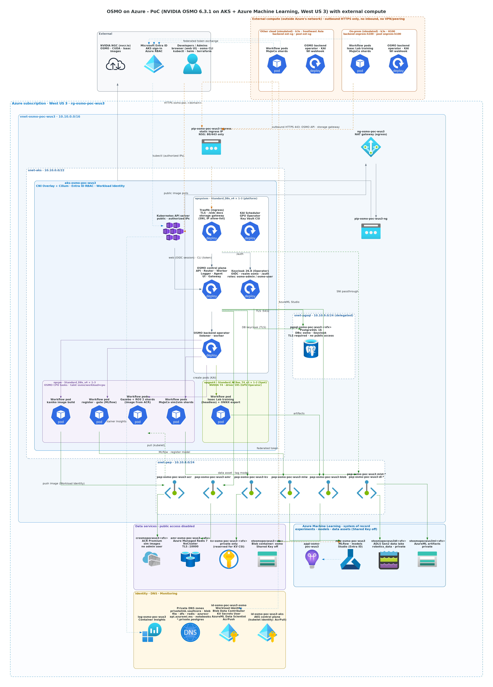

# 多云 + 本地作业的结果集中到 Azure：私有存储的安全设计

> 适用场景：仿真、训练作业分布在 Azure、其他云厂商和本地机房执行，作业的数据、日志、模型和验证结果集中存放在 Azure 的私有存储中统一管控。本文说明这套设计如何满足企业级安全要求，以及每一层控制分别对应哪项最佳实践。

## 1. 结论先行

| 关注点 | 本方案的做法 | 对应的最佳实践 |
|---|---|---|
| 存储有没有暴露在公网上 | **没有。** 所有存储账号关闭公网访问（订阅策略强制，不能被误开），只能通过私有终结点访问 | Microsoft 云安全基准（MCSB）NS-2：用私有链接保护云服务；Azure Storage 安全基线 |
| 外部算力怎么进来 | 只经过一个公网入口（HTTPS 443），按目标域名透传 TLS 到私有终结点，**只放行登记过的外部集群出口 IP** | 零信任“显式验证”；NS-1/NS-2 网络分段与访问控制 |
| 传输是否加密 | TLS 1.2+，**端到端**到 Azure 存储服务本身（入口不解密，证书是 Azure 存储自己的） | MCSB DP-3：传输中加密 |
| 用什么凭据访问 | **不使用账号密钥**（存储账号禁用 Shared Key）。用 Entra ID 令牌（托管身份）或由 Entra ID 签名的短时效 SAS | MCSB IM-1/IM-3：集中身份、托管身份；DP-6：避免长期密钥 |
| 外部集群拿什么身份 | 工作负载身份联合：外部集群自己的服务账号令牌换取 Azure 托管身份的短时令牌，**不分发任何密钥**；可随时在 Azure 侧撤销信任 | MCSB IM-3；与阿里云 ACK RRSA 等机制对应 |
| 权限范围 | 托管身份只有数据面角色（Blob 数据读写、AzureML 数据科学家），没有管理面权限；SAS 只作用于单个容器 | 最小权限（MCSB PA-7） |
| 静态数据 | Azure 存储默认 AES-256 加密（可升级为客户管理密钥） | MCSB DP-4/DP-5 |
| 可追溯 | 每次作业、模型版本、验证结果都关联 OSMO 工作流 ID、数据版本，并记录在 AzureML 中 | MCSB LT（日志与威胁检测）；数据血缘 |

一句话：**外部算力只能“带着短时凭据、从登记过的地址、经加密通道”访问到 Azure 中指定的数据；数据本身从不暴露在公网上，也不依赖任何长期密钥。**

## 2. 架构



数据流（以外部集群中的一个作业为例）：

```
外部集群 Pod ──(1) 服务账号令牌──▶ Entra ID ──(2) 托管身份的短时访问令牌──▶ Pod
外部集群 Pod ──(3) DNS：<存储账号>.blob.core.windows.net → 公网入口 IP
外部集群 Pod ──(4) TLS(SNI=<存储账号>.blob…) ──▶ 公网入口 :443
                                         │  只放行登记过的出口 IP，否则直接断开
                                         └─(5) 原样透传 TCP ──▶ 私有终结点 ──▶ 存储账号
                                                （TLS 在 Pod 和 Azure 存储之间端到端）
存储账号 ──(6) 校验 Entra 令牌 / SAS 签名、RBAC 权限 ──▶ 允许或拒绝
```

## 3. 分层控制

### 3.1 网络层：存储不上公网

- 存储账号（作业数据与日志、AzureML 产物、数据湖）`publicNetworkAccess = Disabled`。在 MCAPS 等受管订阅中，管理组策略（Modify）会强制关闭存储账号的公网访问，即使配置被误改也会被自动纠正。
- Azure 内部（AKS）通过私有终结点 + 私有 DNS 访问。
- **外部算力的唯一入口是存储网关**：复用 OSMO 的公网 HTTPS 入口（固定公网 IP + NSG 只开 80/443），按 SNI 把 `<账号>.blob/dfs.core.windows.net` 的连接透传到对应私有终结点（`deploy/scripts/09-external-backend.sh gateway`）：
  - **IP 白名单**：只允许外部集群的出口 IP（Terraform 输出 `external_access_cidrs`），其他来源的连接在握手前被丢弃；
  - **只路由登记过的存储域名**：网关不是通用代理，不能借道访问其他服务；
  - **不终止 TLS**：网关看不到明文，也不持有存储的证书或凭据。
- 容器镜像仓库（ACR）同样只放行这些出口 IP。

### 3.2 身份层：没有长期密钥

| 访问方 | 凭据 | 有效期 | 撤销方式 |
|---|---|---|---|
| Azure 内的作业（AKS） | Workload Identity → 托管身份 `id-osmo` 的 Entra 令牌 | 约 1 小时，自动续期 | 删除联合凭据或角色分配 |
| 外部集群的作业 | 外部集群服务账号令牌 → **联合凭据** → 同一托管身份的 Entra 令牌 | 约 1 小时，自动续期 | 删除该集群的联合凭据（`fic-ext-<集群名>`），立即失效 |
| OSMO 作业产物上传（osmo-ctrl） | 用户委托 SAS（由 Entra ID 签名，非账号密钥），仅限一个容器，仅 HTTPS | 7 天，每 3 天轮换 | 撤销托管身份的委托密钥 / 轮换 |
| 运维人员 | Entra ID 登录 + Azure RBAC | 会话级 | 条件访问、PIM |

- 存储账号 `allowSharedKeyAccess = false`：即使有人拿到账号密钥也无法使用，也不存在可泄露的长期连接串。
- 外部集群的 OIDC 公钥文档发布在 OSMO 的 HTTPS 入口上，Entra ID 据此验证外部集群签发的令牌；令牌的受众固定为 `api://AzureADTokenExchange`，主体固定为工作流的服务账号，其他 Pod 无法冒用。

### 3.3 权限层：最小权限

- 托管身份只有**数据面**角色：Storage Blob Data Contributor（作业存储、AzureML 存储、数据湖）、AzureML Data Scientist、AcrPush；没有订阅或资源组的管理权限。
- 作业产物的 SAS 只覆盖一个容器的读写。
- AzureML 中的模型晋级（`stage=production`）由门禁任务按规则打标签完成，过程留痕。

### 3.4 数据层：加密、留痕、可追溯

- 静态加密：Azure 存储默认 AES-256；需要时可切换为 Key Vault 中的客户管理密钥（CMK）。
- 每个模型版本记录：训练所在的资源池和 OSMO 工作流 ID、源代码 commit、所用的场景数据版本、每个仿真器的验证结果。混合运行的分片结果按 `sim2sim-runs/<run_id>/<资源池>/` 写入数据湖，能看到哪一部分结果来自哪里。
- 入口（Traefik）的访问日志记录来源 IP；AKS 接入 Container Insights。

## 4. 为什么多云 + 本地场景下仍然可控

多云混合的难点在于“访问方不在自己的网络里”。本方案把复杂度收敛到三个可以集中管理的清单上，全部在 Azure 一侧：

1. **哪些地址可以进来**：`external_access_cidrs`（Terraform 变量 `external_extra_cidrs` + 外部集群的出口 IP）。增减一个外部集群 = 改一行配置。
2. **哪些集群的身份被信任**：托管身份上的联合凭据（Terraform 变量 `external_oidc_issuers`），每个集群一条，可单独撤销。
3. **这些身份能访问什么**：Azure RBAC 角色分配，集中在 Terraform 中。

外部集群一侧**不需要保存任何 Azure 密钥**，只需要能发起出站 HTTPS 连接；也不需要开放任何入站端口（PoC 中外部虚拟机连 SSH 都没有开放，运维走云厂商的管理面通道），不需要和 Azure 建立网络互联。即使外部集群被攻破，攻击者能得到的也只是短时令牌，而且只能从登记过的出口访问登记过的存储域名。

## 5. 走向生产时的建议

| 项 | PoC 现状 | 生产建议 |
|---|---|---|
| 存储网关 | AKS 内的 Traefik TCP 透传 | 托管服务：**Azure Front Door Premium + Private Link 源站**（WAF、DDoS 防护、按地域 / IP 规则），或 Application Gateway；跨境大流量可用 ExpressRoute / 云厂商互联 + VPN |
| 身份粒度 | 所有集群共用一个托管身份 | **每个外部集群一个托管身份**，各自只授予需要的容器或路径权限（例如只能写自己的结果目录），撤销互不影响 |
| 数据范围 | 一个数据湖容器 | 按项目 / 数据级别拆分容器；结果目录启用不可变存储（WORM）和版本控制，防篡改、可回溯 |
| 威胁检测 | 未启用 | Microsoft Defender for Storage（异常访问、恶意文件）、Defender for Containers |
| 日志 | 入口访问日志、Container Insights | 存储、Key Vault、ACR 的诊断日志接入 Log Analytics / Microsoft Sentinel；告警非白名单来源的连接尝试 |
| 加密密钥 | 平台管理密钥 | 需要时启用客户管理密钥（CMK）和双重加密 |
| 作业产物凭据 | 7 天用户委托 SAS（OSMO 6.3.1 的限制） | 升级 OSMO 6.4 后改为纯托管身份 |
| 合规 | 数据可以出境（项目前提） | 跨境传输的范围和类型由客户按所在地法规评估；建议只把指标、模型和验证结果集中到 Azure，原始数据按需保留在本地 |

## 6. 相关文件

| 内容 | 位置 |
|---|---|
| 存储网络规则、外部集群资源、联合凭据 | `infra/terraform/storage.tf`、`azureml.tf`、`acr.tf`、`external.tf` |
| 存储网关、OIDC 文档服务、外部集群接入 | `deploy/scripts/09-external-backend.sh` |
| 外部集群（k3s）安装 | `deploy/scripts/external/k3s-node.sh` |
| 作业产物 SAS 轮换 | `deploy/manifests/workflow-data-sas-rotator.yaml` |
| 端到端验证（联合身份、私有数据湖、产物上传） | `deploy/workflows/external-smoke.yaml` |
