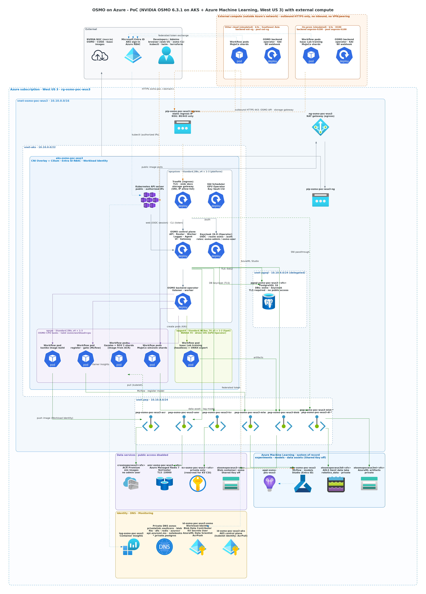

# OSMO on Azure: infrastructure (Terraform)

English | [简体中文](README.zh-CN.md)

This module provisions the Azure infrastructure for PoC phase 1. OSMO 6.3.1 runs on top of it but is not deployed here; it is installed with Helm in a separate step.

## Architecture



_Edges: green = private (VNet / Private Link) · orange dashed = public entry (AKS API: admin IPs only; HTTPS ingress via Traefik: internet, OSMO/Keycloak authentication) · grey = outbound via NAT · blue dotted = identity / monitoring._

| Component | Access | Notes |
|---|---|---|
| AKS API server | Public endpoint with authorized IP ranges | Local accounts are disabled; sign-in uses Entra ID. The deployer gets the cluster admin role. |
| PostgreSQL Flexible Server 16 | Private only (VNet-injected) | `require_secure_transport=on`. The hstore, uuid-ossp and pg_stat_statements extensions are allow-listed. |
| Azure Managed Redis | Private only (private endpoint) | `NoCluster` clustering policy (OSMO runs multi-key pipelines; see deploy/README.md), TLS on port 10000 |
| Blob storage | Private only (private endpoint) | Shared Key is disabled. OSMO uses Workload Identity, plus a user delegation SAS for workflow data on OSMO 6.3.1. |
| Key Vault | Private only (private endpoint) | Reserved for in-cluster secret management (Key Vault CSI). Terraform does not write secrets into it; see Notes. |
| GPU node pool | — | NVIDIA T4, **Spot** priority by default (Regular is available), can scale to zero, but keep `gpu_node_min_count = 1` while testing because OSMO rejects submissions to an empty platform. `gpu_driver=None`: the GPU Operator installs the driver. |
| System node pool (`npsystem`) | — | `Standard_D8s_v4` × 1–3. Runs the platform only: OSMO control plane, Traefik, KAI, GPU Operator controllers and policy-injected components. |
| CPU task node pool (`npcpu`) | — | `Standard_D8s_v4` × 1–3, with taint `osmo/workload=cpu:NoSchedule`. Dedicated to OSMO CPU tasks (the `default` platform). Keep at least 1 node, because OSMO rejects tasks for a platform that has no free capacity. |
| Public ingress (Traefik) | Static public IP `pip-<base>-ingress`, plus NSG `nsg-<base>-aks` on `snet-aks` | Only 80/443 to the ingress IP are allowed from the Internet. Traefik binds to this IP (see deploy/README.md, step 5). |
| AzureML workspace (`azureml.tf`) | Public endpoint with Entra ID + RBAC (`aml_public_network_access_enabled`, default on, so Studio works in a browser), plus a private endpoint | Basic SKU, system-assigned identity, identity-based access to its default storage (no Shared Key). System of record for experiments (MLflow), models and data assets. The AzureML AKS extension is **not** installed: OSMO stays the executor. |
| Container registry ACR (`acr.tf`, `acr_enabled`, default on) | Private endpoint; with external backends also the public endpoint, allow-listed to the external egress IPs | Premium (required for private endpoints), admin user disabled. The AKS kubelet identity has AcrPull; the OSMO workload identity has AcrPush, and images are built and pushed by an OSMO task inside the cluster (`deploy/workflows/build-image.yaml`). Holds prebuilt simulation images such as the Gazebo (ROS 2) image. |
| External compute simulation (`external.tf`, `external_backends_enabled`, default off) | k3s VM in its own resource group, VNet and region (`external_location`, default Southeast Asia); no inbound rules at all (operate it with `az vm run-command`) | Stands in for another cloud's cluster. Adds the external egress IPs (`external_extra_cidrs` + this VM) to the ACR allow-list and the storage gateway allow-list (output `external_access_cidrs`), and one federated credential on the OSMO identity per external OIDC issuer (`external_oidc_issuers`). Storage accounts stay private-only. |
| AzureML default storage / robotics data lake (ADLS Gen2) | Private only (private endpoints: blob + file / blob + dfs) | Shared Key disabled. The data lake simulates the customer's robot data store and is registered as the AzureML datastore `robotics_data` (identity-based). |

Platform images are pulled directly from public registries such as nvcr.io; the private ACR only holds simulation images that need to be prebuilt.

## Resource naming

Names follow the [CAF abbreviations](https://learn.microsoft.com/azure/cloud-adoption-framework/ready/azure-best-practices/resource-abbreviations)
and the [Azure naming rules](https://learn.microsoft.com/azure/azure-resource-manager/management/resource-name-rules).
They are all defined in `naming.tf`:

```
<abbreviation>-<workload>-<environment>-<region>[-<purpose>][-<unique suffix>]
```

| Variable | Default | Notes |
|---|---|---|
| `workload` | `osmo` | Lowercase letters and digits, 2–8 characters |
| `environment` | `poc` | Lowercase letters and digits, 2–5 characters |
| `location_short` | Inferred from the region (westus3 → `wus3`) | Required for regions not in the built-in map |
| `unique_suffix` | First 4 characters of a hash of the subscription ID | Used only for globally unique resources. It is known before deployment and stays the same across redeployments. |
| `resource_group_name` | `rg-<workload>-<environment>-<region>` | Can be overridden on its own |

Default names (`<sfx>` is the unique suffix):

| Resource | Name |
|---|---|
| Resource group / AKS node resource group | `rg-osmo-poc-wus3` / `rg-osmo-poc-wus3-aksnodes` |
| VNet / subnets | `vnet-osmo-poc-wus3` / `snet-aks`, `snet-pep`, `snet-pgsql` |
| NAT gateway / public IP | `ng-osmo-poc-wus3` / `pip-osmo-poc-wus3-ng` |
| AKS / node pools | `aks-osmo-poc-wus3` / `npsystem`, `npcpu`, `npgput4` |
| Managed identities | `id-osmo-poc-wus3-aks` (control plane), `id-osmo-poc-wus3-osmo` (OSMO workloads) |
| PostgreSQL | `pgsql-osmo-poc-wus3-<sfx>`, with private DNS zone `osmo-poc-wus3.private.postgres.database.azure.com` |
| Managed Redis | `amr-osmo-poc-wus3-<sfx>` |
| Storage account / container | `stosmopocwus3<sfx>` / `osmo` |
| Key Vault | `kv-osmo-poc-wus3-<sfx>` |
| Private endpoints / NICs | `pep-osmo-poc-wus3-{kv,blob,amr}` / `nic-pep-osmo-poc-wus3-{kv,blob,amr}` |
| Log Analytics / DCR | `log-osmo-poc-wus3` / `dcr-osmo-poc-wus3-ci` |
| AzureML workspace / Application Insights | `mlw-osmo-poc-wus3` / `appi-osmo-poc-wus3` |
| AzureML storage / data lake (container) | `stosmopocwus3ml<sfx>` / `stosmopocwus3dl<sfx>` (`robotics-data`) |
| AzureML private endpoints | `pep-osmo-poc-wus3-{mlw,mlst-blob,mlst-file,dl-blob,dl-dfs}` |
| ACR / private endpoint | `crosmopocwus3<sfx>` / `pep-osmo-poc-wus3-acr` |

Some names are fixed and do not follow these variables:
- The `privatelink.*` private DNS zones (names set by Azure)
- The DCR association `ContainerInsightsExtension` (Container Insights convention)
- The federated credentials `fic-<key>`

During `terraform plan`, `naming.tf` checks the length and allowed characters of the Key Vault, storage account and other constrained names.

## Prerequisites

- Terraform 1.9 or later, and the Azure CLI signed in (`az login`)
- Subscription permissions: Owner, or Contributor plus User Access Administrator, because the module creates role assignments
- **GPU quota.** The quota must cover `gpu_node_max_count × vCPUs per node` (NC8as has 8 vCPUs).
  - Spot (default) uses the `Total Regional Low-priority vCPUs` quota.
  - Regular uses the `Standard NCASv3_T4 Family vCPUs` quota.

  Check it with:

  ```bash
  az vm list-usage -l westus3 -o table | grep -iE "NCAS|Low-priority"
  ```

  The GPU node pool is still created when the quota is 0, because its minimum size is 0, but it cannot scale out.
- **Spot trade-offs.** Spot costs about 30% of the on-demand price. In West US 3, NC8as_T4 costs $0.21/h on Spot and $0.75/h on demand (November 2026 prices). Nodes can be evicted and capacity is not guaranteed, which is acceptable for a PoC. Spot nodes carry the taint `kubernetes.azure.com/scalesetpriority=spot:NoSchedule`, so the GPU Operator and OSMO workflow pods must tolerate it.
- [kubelogin](https://azure.github.io/kubelogin/) to access the cluster. `az aks install-cli` installs it.

## Deploy

```bash
cd infra/terraform
cp terraform.tfvars.example terraform.tfvars
# Set subscription_id and admin_ip_cidrs (find your egress IP with: curl -s ifconfig.me)

terraform init
terraform plan -out tfplan
terraform apply tfplan
```

Managed Redis is slow to provision, so expect the whole apply to take 20–40 minutes.

Then fetch the cluster credentials:

```bash
$(terraform output -raw aks_get_credentials_command)
kubectl get nodes
```

## Key outputs

| Output | Used for |
|---|---|
| `osmo_identity_client_id` | The `azure.workload.identity/client-id` annotation on OSMO service accounts |
| `ingress_public_ip` / `ingress_public_ip_name` | Static IP for the public HTTPS entry. Point the DNS A record at it. |
| `postgres_fqdn` / `postgres_db_name` / `postgres_admin_username` | OSMO database connection |
| `redis_hostname` / `redis_port` | OSMO Redis connection (TLS) |
| `storage_account_name` / `storage_container_name` / `storage_blob_endpoint` | Storage for OSMO workflow data, logs and artifacts |
| `postgres_admin_password` / `redis_primary_key` | Sensitive. Read by `deploy/scripts/02-osmo-service.sh` and stored as Kubernetes Secrets |
| `key_vault_name` / `key_vault_uri` | Private Key Vault for later Key Vault CSI integration |
| `aml_workspace_name` / `aml_workspace_id` | AzureML workspace used by `deploy/scripts/07-azureml-loop.sh` |
| `acr_name` / `acr_login_server` | Private ACR, used by `deploy/scripts/08-legged-sim2sim.sh` (build and run the Gazebo image) and `02-osmo-service.sh` (skip OSMO's submit-time check for this registry) |
| `data_lake_account_name` / `data_lake_container_name` / `data_lake_datastore_name` | Robotics data lake and its AzureML datastore |

## Notes

- **Workload Identity service account names.** The defaults in `osmo_workload_identity_subjects` match the OSMO 6.3.1 chart defaults: `osmo` for the service chart, and a backend-operator release named `osmo-operator`. If you change the release names or namespaces when deploying OSMO, update this variable and apply again.
- **Key Vault is private-only.** Some subscriptions, such as MCAPS, have a policy that forces Key Vault public network access off. Writing secrets is a data-plane operation, so Terraform cannot do it from outside the VNet. The PostgreSQL password and Redis key are therefore exposed as sensitive outputs instead.
- **Subscription policies.** Policies can also add `ip_tags` to public IPs. The NAT public IP ignores `ip_tags` changes so that it is not recreated and the egress IP does not change. Defender for Cloud may also enable Microsoft Defender on AKS; the cluster ignores `microsoft_defender` because the subscription manages it.
- **Admin IP changes.** If your egress IP changes, update `admin_ip_cidrs` and apply. Until you do, you cannot reach the AKS API.
- **Sensitive values.** The PostgreSQL password and the Redis key are stored in the Terraform state. The PoC uses local state, so never commit state files. Production should use an encrypted remote backend, such as Azure Storage.
- **Teardown.** `terraform destroy` removes every resource and purges the Key Vault.

## Validation log

- 2026-11-05: With azurerm 5.12.0, azapi 2.13.0 and Terraform 1.17.1, `terraform validate` passed and `terraform plan` against the target subscription passed (48 resources). Not applied yet.
- 2026-11-05: Naming switched to the CAF convention (`naming.tf`). `validate` and `plan` passed again.
- 2026-11-06: AzureML integration (`azureml.tf`) applied: 23 resources added, none replaced. The OSMO identity gets `AzureML Data Scientist` on the workspace and `Storage Blob Data Contributor` on the AzureML storage and the data lake.
