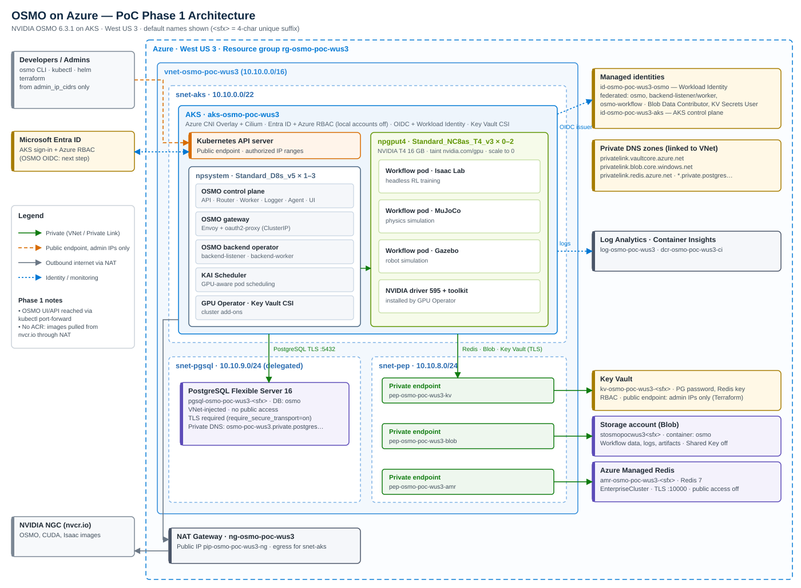

# OSMO on Azure：基础设施（Terraform）

[English](README.md) | 简体中文

PoC 第一阶段使用的 Azure 基础设施，为 OSMO 6.3.1 提供运行环境。OSMO 本身（Helm）不在这里部署。

## 架构



| 组件 | 访问方式 | 说明 |
|---|---|---|
| AKS API Server | 公网 + IP 白名单 | 禁用本地账号，用 Entra ID 登录；部署者自动获得集群管理员权限 |
| PostgreSQL Flexible 16 | 仅私网（VNet 注入） | `require_secure_transport=on`；已启用 hstore、uuid-ossp、pg_stat_statements |
| Azure Managed Redis | 仅私网（PE） | EnterpriseCluster 集群策略，TLS 端口 10000 |
| Blob 存储 | 仅私网（PE） | 禁用 Shared Key，OSMO 通过 Workload Identity 访问 |
| Key Vault | PE + 公网仅放行 admin IP | 存放 PG 密码和 Redis 密钥；Terraform 写入 secret 需要公网入口 |
| GPU 节点池 | — | T4、Regular 优先级、可缩容到 0；`gpu_driver=None`，驱动由 GPU Operator 安装 |

ACR 不在第一阶段范围内，镜像直接从 nvcr.io 拉取。

## 资源命名

遵循 [CAF 资源缩写](https://learn.microsoft.com/azure/cloud-adoption-framework/ready/azure-best-practices/resource-abbreviations)
和 [Azure 命名规则](https://learn.microsoft.com/azure/azure-resource-manager/management/resource-name-rules)，
统一在 `naming.tf` 中定义：

```
<缩写>-<workload>-<environment>-<region>[-<用途>][-<唯一后缀>]
```

| 变量 | 默认值 | 说明 |
|---|---|---|
| `workload` | `osmo` | 小写字母数字，2-8 位 |
| `environment` | `poc` | 小写字母数字，2-5 位 |
| `location_short` | 自动推断（westus3 → `wus3`） | 未内置的区域需手动指定 |
| `unique_suffix` | 订阅 ID 哈希的前 4 位 | 只用于全局唯一的资源，部署前即可确定，重复部署不变 |
| `resource_group_name` | `rg-<workload>-<environment>-<region>` | 可单独覆盖 |

默认值下的资源名称（`<sfx>` 为唯一后缀）：

| 资源 | 名称 |
|---|---|
| 资源组 / AKS 节点资源组 | `rg-osmo-poc-wus3` / `rg-osmo-poc-wus3-aksnodes` |
| VNet / 子网 | `vnet-osmo-poc-wus3` / `snet-aks`、`snet-pep`、`snet-pgsql` |
| NAT Gateway / 公网 IP | `ng-osmo-poc-wus3` / `pip-osmo-poc-wus3-ng` |
| AKS / 节点池 | `aks-osmo-poc-wus3` / `npsystem`、`npgput4` |
| 托管身份 | `id-osmo-poc-wus3-aks`（控制面）、`id-osmo-poc-wus3-osmo`（OSMO 工作负载） |
| PostgreSQL | `pgsql-osmo-poc-wus3-<sfx>`，私有 DNS 区域 `osmo-poc-wus3.private.postgres.database.azure.com` |
| Managed Redis | `amr-osmo-poc-wus3-<sfx>` |
| 存储账号 / 容器 | `stosmopocwus3<sfx>` / `osmo` |
| Key Vault | `kv-osmo-poc-wus3-<sfx>` |
| 私有终结点 / 网卡 | `pep-osmo-poc-wus3-{kv,blob,amr}` / `nic-pep-osmo-poc-wus3-{kv,blob,amr}` |
| Log Analytics / DCR | `log-osmo-poc-wus3` / `dcr-osmo-poc-wus3-ci` |

固定名称（不随变量变化）：私有 DNS 区域 `privatelink.*`（Azure 规定）、DCR 关联 `ContainerInsightsExtension`
（Container Insights 约定）、Key Vault secret `postgres-admin-password` / `redis-primary-key`、
联邦凭据 `fic-<key>`。`naming.tf` 会在 plan 阶段校验 Key Vault、存储账号等名称的长度和字符。

## 前置条件

- Terraform >= 1.9；Azure CLI 已登录（`az login`）
- 订阅权限：Owner，或 Contributor + User Access Administrator（需要创建角色分配）
- **GPU 配额**：`Standard NCASv3_T4 Family vCPUs` 至少要能容纳 `gpu_node_max_count × 单机 vCPU`
  （NC8as = 8 vCPU）。检查方式：

  ```bash
  az vm list-usage -l westus3 -o table | grep -i NCAS
  ```

  配额为 0 时 GPU 节点池仍能创建（最小 0 节点），但无法扩容出节点。
- 访问集群需要 [kubelogin](https://azure.github.io/kubelogin/)（`az aks install-cli` 会一并安装）

## 部署

```bash
cd infra/terraform
cp terraform.tfvars.example terraform.tfvars
# 修改 subscription_id、admin_ip_cidrs（curl -s ifconfig.me 查询本机出口 IP）

terraform init
terraform plan -out tfplan
terraform apply tfplan
```

Managed Redis 创建较慢，整个 apply 预计 20–40 分钟。

部署完成后获取集群凭据：

```bash
$(terraform output -raw aks_get_credentials_command)
kubectl get nodes
```

## 主要输出

| 输出 | 用途 |
|---|---|
| `osmo_identity_client_id` | OSMO ServiceAccount 的 `azure.workload.identity/client-id` 注解 |
| `postgres_fqdn` / `postgres_db_name` / `postgres_admin_username` | OSMO 数据库连接 |
| `redis_hostname` / `redis_port` | OSMO Redis 连接（TLS） |
| `storage_account_name` / `storage_container_name` / `storage_blob_endpoint` | OSMO 工作流数据、日志、产物存储 |
| `key_vault_name` / `key_vault_secret_names` | 通过 Key Vault CSI 获取 PG 密码和 Redis 密钥 |

## 注意事项

- **Workload Identity 的 ServiceAccount 名称**：`osmo_workload_identity_subjects` 的默认值按 OSMO 6.3.1
  chart 的默认命名设置（service 用 `osmo`，backend-operator 的 release 名假设为 `osmo-operator`）。
  部署 OSMO 时如修改了 release 名或命名空间，需同步修改并重新 apply。
- **Key Vault 公网入口**：Terraform 写入 secret 是数据面操作，因此对 `admin_ip_cidrs` 开放。
  部署完成后如需完全关闭，可将 `public_network_access_enabled` 改为 `false` 后再 apply，
  但之后从部署机修改 secret 需要经由 VNet 内的跳板机。
- **admin IP 变化**：本机出口 IP 变化后需更新 `admin_ip_cidrs` 并 apply，否则无法访问 AKS API 和 Key Vault。
- **敏感信息**：PG 密码和 Redis 密钥会保存在 Terraform state 中。PoC 使用本地 state，请勿提交 state 文件；
  正式环境应改用加密的远程 backend（如 Azure Storage）。
- **销毁**：`terraform destroy` 会删除全部资源，Key Vault 会被直接清除（purge）。

## 验证记录

- 2026-11-05：azurerm 5.12.0 / azapi 2.13.0 / Terraform 1.17.1，`terraform validate` 通过，
  对目标订阅 `terraform plan` 通过（48 个资源）。尚未 apply。
- 2026-11-05：命名改为 CAF 规范（`naming.tf`），validate 和 plan 再次通过。
